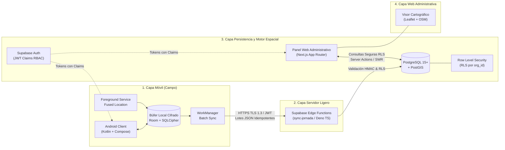
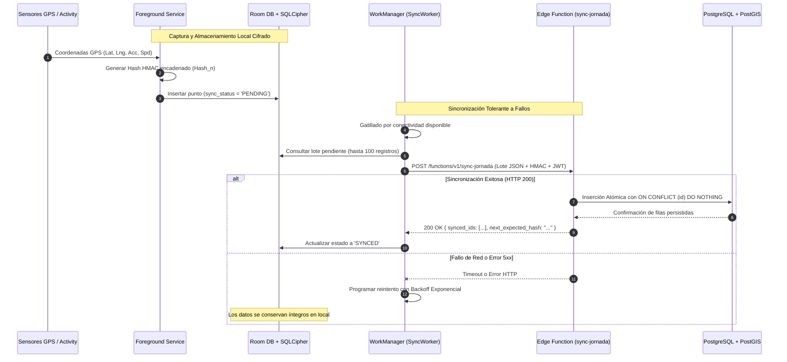
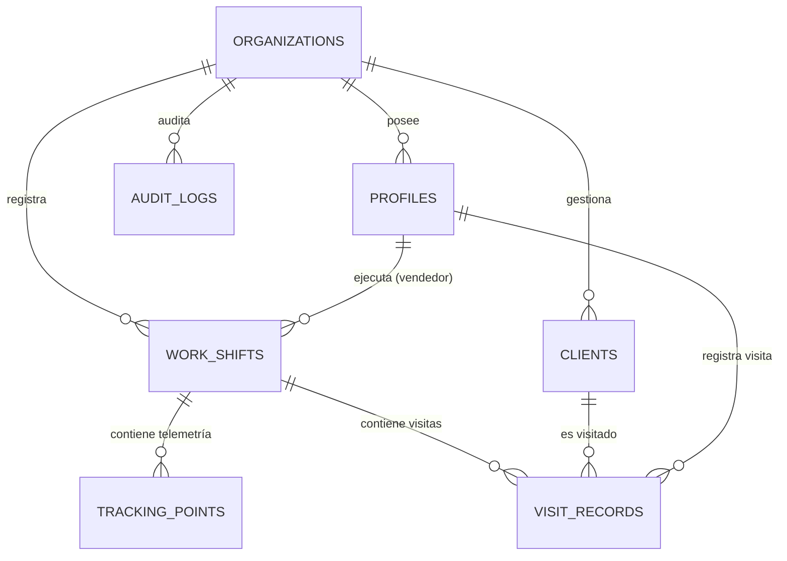

# Arquitectura del Sistema — ROUTRACK

**Proyecto:** ROUTRACK  
**Documento:** Especificación Técnica de Arquitectura de Software  
**Versión:** 1.0.0  
**Fecha:** Noviembre 2026  
**Estado:** Documento Fundacional Oficial (Aprobado)  
**Autor:** Senior Software Engineer, Cloud/Mobile Solutions Architect & Technical Lead  

---

## 1. Arquitectura General Desacoplada

ROUTRACK está diseñado bajo una **arquitectura en capas desacoplada, orientada a servicios serverless y con soporte nativo Offline-First**. 

El flujo de procesamiento sigue una secuencia estricta de extremo a extremo:
$$\text{Android Client} \longrightarrow \text{Supabase Edge Functions} \longrightarrow \text{PostgreSQL + PostGIS} \longrightarrow \text{Panel Web Administrativo}$$



### 1.1. Separación Estricta de Capas
1. **Regla de Oro:** La interfaz de usuario (sea Android Compose o React en el panel web) **nunca accede directamente a las tablas de la base de datos sin mediación de capas de autorización o validación**.
2. **Capa Móvil:** La UI interactúa exclusivamente con la capa de dominio y repositorios locales. La base de datos local SQLite (Room) actúa como la única fuente de verdad inmediata en el teléfono.
3. **Capa de Ingesta Backend (Supabase Edge Functions):** Toda ingesta masiva de telemetría y eventos de jornada proveniente de los dispositivos móviles es recibida por la Edge Function `sync-jornada`. Dicha función:
   - Valida el token JWT del usuario.
   - Verifica la firma criptográfica HMAC-SHA256 del lote para certificar la cadena de custodia.
   - Aplica validaciones de esquema estricto (Zod).
   - Ejecuta la persistencia idempotente en PostgreSQL mediante transacciones atómicas.
4. **Capa de Datos (PostgreSQL + PostGIS):** Alberga la lógica de integridad geoespacial (cálculo de geocercas con `ST_DWithin`, detección de desvíos espaciales) y el aislamiento estricto entre organizaciones mediante políticas de Row Level Security (RLS).
5. **Capa Web Administrativa:** La aplicación Next.js ejecuta sus consultas de lectura principalmente del lado del servidor mediante Server Components y Server Actions, utilizando el cliente `@supabase/ssr` con cookies HttpOnly seguras y respetando las políticas RLS.

---

## 2. Estructura del Monorepo

El repositorio está organizado en un monorepo modular limpio, desacoplado y tipado:

```text
routrack/
├── .agent/                    # Reglas operativas para agentes IA (Google Antigravity)
│   └── rules/
│       └── rules.md
├── .agents/                   # Espejo de compatibilidad para descubrimiento jerárquico
│   └── rules/
│       └── rules.md
├── docs/                      # Documentación fundacional técnica (Single Source of Truth)
│   ├── PRD.md                 # Product Requirement Document y alcance MVP
│   ├── ARCHITECTURE.md        # Arquitectura del sistema, esquema PostGIS y contratos
│   ├── DESIGN.md              # Sistema de diseño, paleta semántica y componentes UI
│   ├── TEST_PLAN.md           # Plan de pruebas, mitigación de spoofing y pirámide
│   ├── SECURITY.md            # Modelo de amenazas, RLS, SQLCipher y LOPDP Ecuador
│   ├── DECISIONS.md           # Architectural Decision Records (ADR-001 a ADR-008)
│   └── MEMORY.md              # Bitácora viva del estado y sincronización del proyecto
├── mobile-android/            # Aplicación Móvil Android Nativa (Kotlin + Jetpack Compose)
│   ├── app/
│   │   ├── src/
│   │   │   ├── main/
│   │   │   │   ├── java/com/routrack/mobile/
│   │   │   │   │   ├── core/          # Utilidades, dispatchers, constantes
│   │   │   │   │   ├── data/          # Room DB, SQLCipher, DAOs, Repositorios
│   │   │   │   │   ├── domain/        # Casos de uso, modelos puros de negocio
│   │   │   │   │   ├── presentation/  # UI Jetpack Compose, ViewModels, UI States
│   │   │   │   │   ├── security/      # KeystoreManager, HmacSigner, AntiSpoofing
│   │   │   │   │   ├── services/      # TrackingForegroundService
│   │   │   │   │   └── workers/       # SyncJornadaWorker (WorkManager)
│   │   │   │   ├── res/               # Drawables, layouts mínimos, strings, themes
│   │   │   │   └── AndroidManifest.xml
│   │   │   └── test/                  # Pruebas unitarias de JUnit y MockK
│   │   └── build.gradle.kts
│   ├── gradle/
│   ├── build.gradle.kts
│   └── settings.gradle.kts
├── supabase/                  # Backend Unificado Serverless en Supabase
│   ├── config.toml            # Configuración local de Supabase CLI
│   ├── functions/             # Supabase Edge Functions (Deno / TypeScript)
│   │   └── sync-jornada/      # Ingesta por lotes, verificación HMAC e idempotencia
│   │       ├── index.ts
│   │       └── schema.ts
│   ├── migrations/            # Migraciones SQL declarativas y versionadas
│   │   ├── 20261106000000_enable_extensions.sql
│   │   ├── 20261106000001_create_core_tables.sql
│   │   ├── 20261106000002_postgis_spatial_indices.sql
│   │   └── 20261106000003_rls_security_policies.sql
│   └── seed.sql               # Datos de prueba para desarrollo local
├── web-admin/                 # Panel Web Administrativo (Next.js App Router + TypeScript)
│   ├── public/                # Recursos estáticos, iconos y marcadores de mapa
│   ├── src/
│   │   ├── app/               # Rutas del App Router (layout, auth, dashboard)
│   │   │   ├── (auth)/login/
│   │   │   ├── (dashboard)/
│   │   │   │   ├── live/      # Monitoreo en vivo con Leaflet
│   │   │   │   ├── routes/    # Histórico de trayectorias y desvíos
│   │   │   │   ├── visits/    # Auditoría de visitas comerciales
│   │   │   │   ├── clients/   # Georreferenciación de clientes
│   │   │   │   └── audit/     # Bitácora inmutable de eventos
│   │   │   └── api/           # Endpoints auxiliares Next.js (si aplican)
│   │   ├── components/        # Componentes UI modulares (Mapas, Tablas, Skeletons)
│   │   ├── hooks/             # Custom React hooks (useRealtimeTracking)
│   │   ├── lib/               # Clientes Supabase SSR, formateadores, geocalc
│   │   └── types/             # Interfaces TypeScript estrictas
│   ├── package.json
│   ├── tailwind.config.ts
│   └── tsconfig.json
├── .env.example               # Plantilla de variables de entorno seguras (sin secretos)
├── .gitignore                 # Exclusiones de Git unificadas para monorepo
├── AGENTS.md                  # Reglas del agente para Google Antigravity (estándar raíz)
├── GEMINI.md                  # Reglas de Antigravity (estándar de directorio)
├── README.md                  # Resumen ejecutivo y guía de incorporación
└── TASKS.md                   # Mapa de ruta secuencial estructurado por Vertical Slices
```

---

## 3. Flujo de Datos Offline-First

El cliente móvil Android opera como un sistema autónomo de captura y buffering, diseñado para tolerar desconexiones prolongadas sin degradar la experiencia de usuario.



### 3.1. Detalle del Flujo de Sincronización
1. **Captura Local Inmediata:** Ninguna interacción o punto GPS espera respuesta de la red. Toda coordenada recibida del `FusedLocationProviderClient` se persiste de forma síncrona en SQLite/Room bajo cifrado SQLCipher.
2. **Encadenamiento Criptográfico en Origen:** Antes de insertar el registro en Room, el módulo de seguridad calcula el hash HMAC-SHA256 utilizando la llave privada custodiada en el Android Keystore, vinculando el punto al hash del registro inmediatamente precedente.
3. **Empaquetado por Lotes (Batching):** El `SyncJornadaWorker` selecciona hasta 100 registros en estado `PENDING`. Empaquetar en lotes reduce dramáticamente el uso de la antena de radio celular, optimizando el consumo de batería y datos móviles en comparación con transmisiones punto a punto.
4. **Política de Reintentos Exponenciales:** Si la transmisión falla por falta de señal, el `WorkManager` aplica una política `BackoffPolicy.EXPONENTIAL` con un retardo inicial de 30 segundos, incrementándose progresivamente hasta un máximo configurado de 5 horas.
5. **Idempotencia Garantizada:** Cada punto de telemetría y visita posee un `UUID v4` generado en el cliente móvil al momento de su captura física. La función de ingesta en backend utiliza la cláusula `ON CONFLICT (id) DO NOTHING`. De este modo, ante retransmisiones duplicadas causadas por caídas abruptas de red, la base de datos ignora los registros repetidos sin corromper la bitácora ni duplicar distancias.

---

## 4. Modelo de Datos y Diseño Geoespacial en PostGIS

ROUTRACK utiliza PostgreSQL 15+ con la extensión **PostGIS 3.3+**, adoptando el estándar de geometrías espaciales `GEOMETRY(Point, 4326)` bajo el sistema de referencia de coordenadas elipsoidal WGS 84 (SRID 4326).



### 4.1. Definición de Tablas Principales

#### 4.1.1. Tabla `organizations` (Inquilinos Multi-Tenant)
```sql
CREATE TABLE public.organizations (
    id UUID PRIMARY KEY DEFAULT gen_random_uuid(),
    name TEXT NOT NULL,
    tax_id TEXT NOT NULL UNIQUE, -- RUC en Ecuador (13 dígitos)
    is_active BOOLEAN NOT NULL DEFAULT TRUE,
    created_at TIMESTAMPTZ NOT NULL DEFAULT NOW(),
    updated_at TIMESTAMPTZ NOT NULL DEFAULT NOW()
);
```

#### 4.1.2. Tabla `profiles` (Usuarios y Roles RBAC)
```sql
CREATE TABLE public.profiles (
    id UUID PRIMARY KEY REFERENCES auth.users(id) ON DELETE CASCADE,
    organization_id UUID NOT NULL REFERENCES public.organizations(id) ON DELETE CASCADE,
    role TEXT NOT NULL CHECK (role IN ('ADMIN', 'SUPERVISOR', 'VENDEDOR')),
    full_name TEXT NOT NULL,
    email TEXT NOT NULL,
    phone TEXT,
    is_active BOOLEAN NOT NULL DEFAULT TRUE,
    created_at TIMESTAMPTZ NOT NULL DEFAULT NOW(),
    updated_at TIMESTAMPTZ NOT NULL DEFAULT NOW()
);
```

#### 4.1.3. Tabla `clients` (Puntos de Venta y Geocercas)
```sql
CREATE TABLE public.clients (
    id UUID PRIMARY KEY DEFAULT gen_random_uuid(),
    organization_id UUID NOT NULL REFERENCES public.organizations(id) ON DELETE CASCADE,
    name TEXT NOT NULL,
    commercial_name TEXT,
    tax_id TEXT,
    address TEXT NOT NULL,
    phone TEXT,
    location GEOMETRY(Point, 4326) NOT NULL,
    tolerance_radius_meters INTEGER NOT NULL DEFAULT 50 CHECK (tolerance_radius_meters > 0),
    created_at TIMESTAMPTZ NOT NULL DEFAULT NOW(),
    updated_at TIMESTAMPTZ NOT NULL DEFAULT NOW()
);

-- Índice espacial GiST para búsquedas de proximidad aceleradas
CREATE INDEX idx_clients_location ON public.clients USING GIST (location);
CREATE INDEX idx_clients_org_id ON public.clients (organization_id);
```

#### 4.1.4. Tabla `work_shifts` (Jornadas Laborales)
```sql
CREATE TABLE public.work_shifts (
    id UUID PRIMARY KEY DEFAULT gen_random_uuid(),
    organization_id UUID NOT NULL REFERENCES public.organizations(id) ON DELETE CASCADE,
    seller_id UUID NOT NULL REFERENCES public.profiles(id) ON DELETE CASCADE,
    start_time TIMESTAMPTZ NOT NULL DEFAULT NOW(),
    end_time TIMESTAMPTZ,
    status TEXT NOT NULL DEFAULT 'OPEN' CHECK (status IN ('OPEN', 'CLOSED', 'ABORTED')),
    start_location GEOMETRY(Point, 4326) NOT NULL,
    end_location GEOMETRY(Point, 4326),
    total_distance_km NUMERIC(8, 2) NOT NULL DEFAULT 0.00,
    battery_level_start INTEGER CHECK (battery_level_start BETWEEN 0 AND 100),
    battery_level_end INTEGER CHECK (battery_level_end BETWEEN 0 AND 100),
    created_at TIMESTAMPTZ NOT NULL DEFAULT NOW()
);

CREATE INDEX idx_work_shifts_org_seller ON public.work_shifts (organization_id, seller_id, start_time DESC);
```

#### 4.1.5. Tabla `tracking_points` (Telemetría GPS Histórica)
```sql
CREATE TABLE public.tracking_points (
    id UUID PRIMARY KEY DEFAULT gen_random_uuid(),
    organization_id UUID NOT NULL REFERENCES public.organizations(id) ON DELETE CASCADE,
    shift_id UUID NOT NULL REFERENCES public.work_shifts(id) ON DELETE CASCADE,
    seller_id UUID NOT NULL REFERENCES public.profiles(id) ON DELETE CASCADE,
    location GEOMETRY(Point, 4326) NOT NULL,
    accuracy_meters REAL NOT NULL,
    speed_ms REAL,
    altitude_meters REAL,
    bearing_degrees REAL,
    battery_level INTEGER CHECK (battery_level BETWEEN 0 AND 100),
    is_mock BOOLEAN NOT NULL DEFAULT FALSE,
    hmac_hash TEXT NOT NULL,
    previous_hash TEXT NOT NULL,
    recorded_at TIMESTAMPTZ NOT NULL,
    created_at TIMESTAMPTZ NOT NULL DEFAULT NOW()
);

-- Índice GiST para análisis espacial de polilíneas y desvíos
CREATE INDEX idx_tracking_points_location ON public.tracking_points USING GIST (location);
CREATE INDEX idx_tracking_points_shift_time ON public.tracking_points (shift_id, recorded_at ASC);
CREATE INDEX idx_tracking_points_org_id ON public.tracking_points (organization_id);
```

#### 4.1.6. Tabla `visit_records` (Visitas Comerciales y Acuerdos)
```sql
CREATE TABLE public.visit_records (
    id UUID PRIMARY KEY DEFAULT gen_random_uuid(),
    organization_id UUID NOT NULL REFERENCES public.organizations(id) ON DELETE CASCADE,
    shift_id UUID NOT NULL REFERENCES public.work_shifts(id) ON DELETE CASCADE,
    client_id UUID NOT NULL REFERENCES public.clients(id) ON DELETE CASCADE,
    seller_id UUID NOT NULL REFERENCES public.profiles(id) ON DELETE CASCADE,
    check_in_time TIMESTAMPTZ NOT NULL,
    check_out_time TIMESTAMPTZ,
    check_in_location GEOMETRY(Point, 4326) NOT NULL,
    check_out_location GEOMETRY(Point, 4326),
    distance_to_client_meters REAL NOT NULL,
    status TEXT NOT NULL CHECK (status IN ('VERIFIED', 'OUT_OF_RANGE', 'CANCELLED')),
    observations TEXT,
    agreed_prices_commitments JSONB, -- Estructura de compromisos comerciales y precios pactados
    hmac_hash TEXT NOT NULL,
    created_at TIMESTAMPTZ NOT NULL DEFAULT NOW()
);

CREATE INDEX idx_visit_records_client ON public.visit_records (client_id);
CREATE INDEX idx_visit_records_shift ON public.visit_records (shift_id);
CREATE INDEX idx_visit_records_org ON public.visit_records (organization_id);
```

#### 4.1.7. Tabla `audit_logs` (Bitácora Inmutable de Eventos)
```sql
CREATE TABLE public.audit_logs (
    id BIGSERIAL PRIMARY KEY,
    organization_id UUID NOT NULL REFERENCES public.organizations(id) ON DELETE CASCADE,
    user_id UUID REFERENCES public.profiles(id) ON DELETE SET NULL,
    event_type TEXT NOT NULL, -- GPS_DISABLED, SIGNAL_LOST, MOCK_LOCATION_DETECTED, SHIFT_OPENED, SHIFT_CLOSED
    event_severity TEXT NOT NULL CHECK (event_severity IN ('INFO', 'WARNING', 'CRITICAL')),
    metadata JSONB NOT NULL DEFAULT '{}'::JSONB,
    location GEOMETRY(Point, 4326),
    hmac_hash TEXT NOT NULL,
    previous_hash TEXT NOT NULL,
    created_at TIMESTAMPTZ NOT NULL DEFAULT NOW()
);

CREATE INDEX idx_audit_logs_org_time ON public.audit_logs (organization_id, created_at DESC);
```

### 4.2. Consultas Geoespaciales Clave en PostGIS

#### 4.2.1. Validación de Geocerca de Visita (`ST_DWithin`)
Dado que las coordenadas residen en `GEOMETRY(Point, 4326)`, para medir distancias métricas exactas sobre la superficie terrestre se castea la geometría a `geography`:
```sql
-- Función de validación de geocerca en check-in
SELECT 
    c.id AS client_id,
    c.name,
    c.tolerance_radius_meters,
    ST_Distance(c.location::geography, ST_SetSRID(ST_MakePoint(:vendedor_lng, :vendedor_lat), 4326)::geography) AS distancia_metros,
    ST_DWithin(
        c.location::geography,
        ST_SetSRID(ST_MakePoint(:vendedor_lng, :vendedor_lat), 4326)::geography,
        c.tolerance_radius_meters
    ) AS esta_en_rango
FROM public.clients c
WHERE c.id = :target_client_id
  AND c.organization_id = :user_org_id;
```

#### 4.2.2. Detección de Desviación de Ruta Planificada
Para determinar si un punto GPS de telemetría se ha desviado respecto a la ruta planificada (modelada como un `LineString` o corredor entre los clientes asignados del día):
```sql
-- Detección de desvío: distancia del punto a la línea óptima de ruta superior al umbral permitido (ej. 300 metros)
SELECT 
    tp.id AS point_id,
    tp.recorded_at,
    ST_Distance(
        tp.location::geography,
        route_corridor.geom::geography
    ) AS desviacion_metros
FROM public.tracking_points tp
CROSS JOIN (
    SELECT ST_MakeLine(location ORDER BY planned_order ASC) AS geom
    FROM daily_route_stops
    WHERE shift_id = :target_shift_id
) route_corridor
WHERE tp.shift_id = :target_shift_id
  AND NOT ST_DWithin(
      tp.location::geography,
      route_corridor.geom::geography,
      300 -- Umbral de tolerancia de desvío en metros
  );
```

---

## 5. Contratos e Interfaces Conceptuales JSON

A continuación se definen los contratos formales para el intercambio de información entre el cliente Android y la Supabase Edge Function `sync-jornada`:

### 5.1. Contrato de Sincronización por Lotes (Batch Payload Android $\rightarrow$ Edge Function)
**Endpoint:** `POST /functions/v1/sync-jornada`  
**Headers:**
```http
Authorization: Bearer <SUPABASE_JWT_ACCESS_TOKEN>
Content-Type: application/json
X-Client-Device-Id: "a3f5b89c-01de-4e78-9a45-67890abcdef1"
X-Client-App-Version: "1.0.0"
```

**Payload JSON:**
```json
{
  "sync_batch_id": "7b8e1f54-8e39-4d22-9642-123456789abc",
  "shift_id": "c1a2b3c4-d5e6-47a8-9b0c-112233445566",
  "organization_id": "f47ac10b-58cc-4372-a567-0e02b2c3d479",
  "seller_id": "99e1a2b3-c4d5-4e6f-a7b8-c9d0e1f2a3b4",
  "batch_timestamp": "2026-11-06T13:45:00.000Z",
  "tracking_points": [
    {
      "id": "11111111-2222-3333-4444-555555555555",
      "latitude": -0.180653,
      "longitude": -78.467834,
      "accuracy_meters": 4.5,
      "speed_ms": 12.3,
      "altitude_meters": 2815.0,
      "bearing_degrees": 182.5,
      "battery_level": 84,
      "is_mock": false,
      "recorded_at": "2026-11-06T13:40:00.000Z",
      "previous_hash": "e3b0c44298fc1c149afbf4c8996fb92427ae41e4649b934ca495991b7852b855",
      "hmac_hash": "a591a6d40bf420404a011733cfb7b190d62c65bf0bcda32b57b277d9ad9f146e"
    },
    {
      "id": "22222222-3333-4444-5555-666666666666",
      "latitude": -0.182410,
      "longitude": -78.468920,
      "accuracy_meters": 3.8,
      "speed_ms": 8.1,
      "altitude_meters": 2814.2,
      "bearing_degrees": 190.0,
      "battery_level": 83,
      "is_mock": false,
      "recorded_at": "2026-11-06T13:43:00.000Z",
      "previous_hash": "a591a6d40bf420404a011733cfb7b190d62c65bf0bcda32b57b277d9ad9f146e",
      "hmac_hash": "c89b7f52093a8d423985bf8a25c7423e8f192b9b788a1b621e289c03fae12089"
    }
  ],
  "visit_records": [
    {
      "id": "33333333-4444-5555-6666-777777777777",
      "client_id": "8a7b6c5d-4e3f-2a1b-0c9d-8e7f6a5b4c3d",
      "check_in_time": "2026-11-06T13:15:00.000Z",
      "check_out_time": "2026-11-06T13:35:00.000Z",
      "check_in_location": {
        "latitude": -0.180550,
        "longitude": -78.467710
      },
      "check_out_location": {
        "latitude": -0.180555,
        "longitude": -78.467715
      },
      "observations": "Cliente solicita reposición urgente de producto categoría A. Local con afluencia normal.",
      "agreed_prices_commitments": {
        "agreed_discount_pct": 5.0,
        "promised_delivery_date": "2026-11-08",
        "order_intent_units": 150,
        "unit_price_pactado": 12.50
      },
      "hmac_hash": "5d41402abc4b2a76b9719d911017c5926c4592a2a095a8946764516335a90d8a"
    }
  ],
  "system_events": [
    {
      "event_type": "GPS_DISABLED",
      "event_severity": "WARNING",
      "occurred_at": "2026-11-06T13:20:15.000Z",
      "metadata": {
        "reason": "USER_ACTION_SETTINGS_TOGGLED",
        "battery_pct": 84
      },
      "previous_hash": "c89b7f52093a8d423985bf8a25c7423e8f192b9b788a1b621e289c03fae12089",
      "hmac_hash": "7a38b1d9236a287b4699fb42e126a1b24f5a31e138a3901bcae0350d738f615e"
    }
  ]
}
```

### 5.2. Contrato de Respuesta del Servidor (Edge Function $\rightarrow$ Android Client)
**Respuesta:** `200 OK`
```json
{
  "status": "SUCCESS",
  "sync_batch_id": "7b8e1f54-8e39-4d22-9642-123456789abc",
  "processed_at": "2026-11-06T13:45:01.120Z",
  "summary": {
    "tracking_points_persisted": 2,
    "tracking_points_ignored_conflict": 0,
    "visit_records_persisted": 1,
    "audit_events_persisted": 1
  },
  "chain_state": {
    "last_verified_hash": "7a38b1d9236a287b4699fb42e126a1b24f5a31e138a3901bcae0350d738f615e",
    "chain_integrity_valid": true
  },
  "visits_evaluation": [
    {
      "visit_id": "33333333-4444-5555-6666-777777777777",
      "evaluated_status": "VERIFIED",
      "distance_to_client_meters": 18.2,
      "tolerance_meters": 50
    }
  ]
}
```

**Respuesta de Error de Validación:** `400 Bad Request`
```json
{
  "status": "ERROR",
  "error_code": "HMAC_CHAIN_TAMPERED",
  "message": "La verificación criptográfica del hash encadenado no coincide con el payload recibido.",
  "failed_entity_id": "22222222-3333-4444-5555-666666666666",
  "timestamp": "2026-11-06T13:45:01.200Z"
}
```
