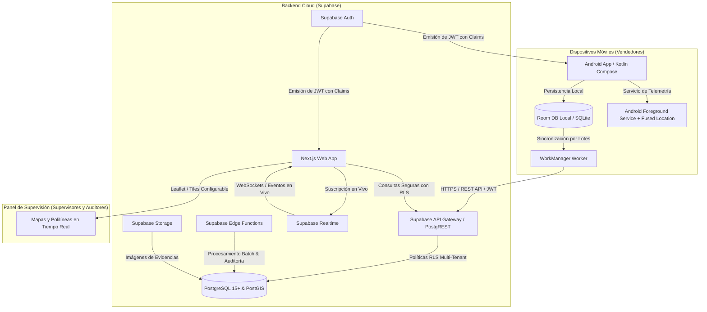
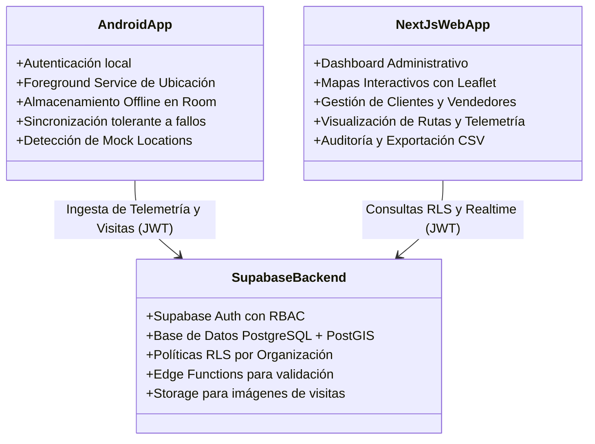
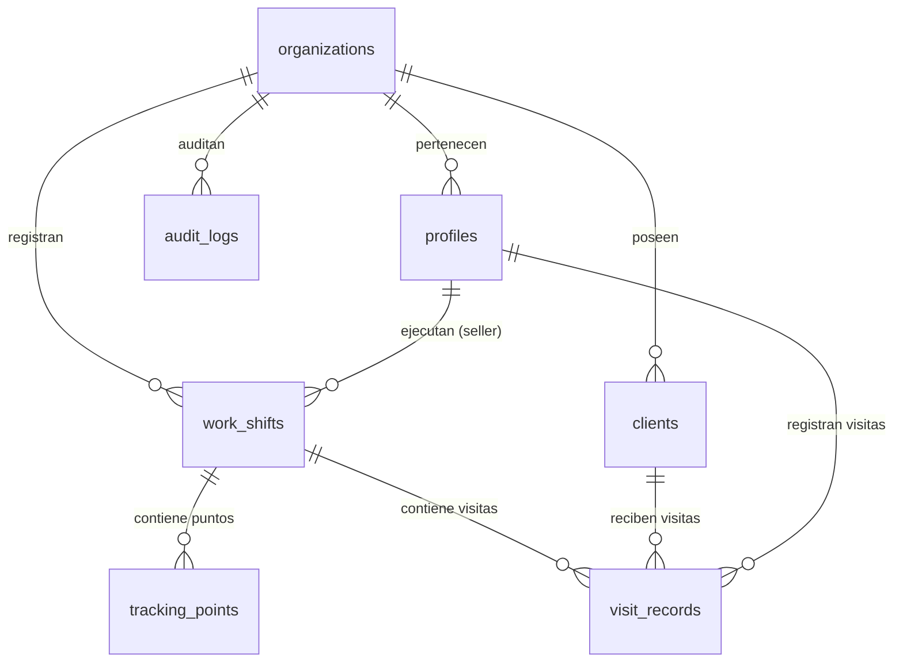

# Arquitectura del Sistema — ROUTRACK

**Proyecto:** ROUTRACK  
**Documento:** Especificación de Arquitectura de Software  
**Versión:** 1.0.0  
**Fecha:** Noviembre 2026  
**Estado:** Base Oficial  

---

## 1. Arquitectura General

ROUTRACK está estructurado bajo una **arquitectura desacoplada, orientada a eventos y con soporte nativo *Offline-First***. El núcleo de la infraestructura se basa en los servicios gestionados de **Supabase** (BaaS) sobre una base de datos relacional y geoespacial PostgreSQL con la extensión PostGIS activada. 

El ecosistema se divide en tres niveles fundamentales:
1. **Capa Móvil (Cliente en Campo):** Aplicación Android nativa desarrollada en Kotlin y Jetpack Compose. Implementa Clean Architecture (UI / Dominio / Datos) con persistencia local en SQLite (Room Database), tareas diferidas tolerantes a fallos (WorkManager) y captura continua de telemetría mediante un Android Foreground Service respaldado por el Fused Location Provider.
2. **Capa Backend y Persistencia (Supabase):** Plataforma integral que provee autenticación de usuarios (Supabase Auth), almacenamiento relacional y espacial (PostgreSQL + PostGIS), almacenamiento de archivos multimedia (Supabase Storage), suscripciones en tiempo real (Supabase Realtime) y lógica de servidor ligera (Supabase Edge Functions en Deno/TypeScript). La seguridad y el aislamiento multi-tenant se aplican estrictamente en el motor de datos mediante Row Level Security (RLS).
3. **Capa Web (Panel de Supervisión y Auditoría):** Aplicación moderna desarrollada en Next.js (App Router) con TypeScript estricto y Tailwind CSS. Utiliza Server Components para renderizado eficiente del lado del servidor, Client Components para la interactividad de mapas con Leaflet y llamadas seguras autenticadas hacia Supabase.



---

## 2. Tecnologías Seleccionadas

| Capa / Módulo | Tecnología | Versión / Especificación | Justificación Técnica |
| :--- | :--- | :--- | :--- |
| **Entorno de Desarrollo** | Google Antigravity | Última estable | IDE asistido por IA para desarrollo ágil y consistente. |
| **Repositorio y VCS** | Git + GitHub | Git 2.40+ | Versionamiento seguro, trazabilidad y control de ramas en repositorio privado. |
| **App Móvil (UI)** | Kotlin + Jetpack Compose | Kotlin 1.9+ / Compose BOM | Estándar moderno oficial de Google para UI declarativa reactiva en Android. |
| **Persistencia Local Móvil** | Room Database | SQLite moderno | Abstracción tipada, segura y reactiva sobre SQLite con soporte de corrutinas. |
| **Tareas en Segundo Plano** | Android WorkManager | API 26+ | Garantiza la ejecución diferida de sincronización incluso si la app se cierra o el SO reinicia. |
| **Telemetría y Rastreo** | Fused Location Provider | Google Play Services Location | Optimización inteligente de consumo de batería combinando GPS, Wi-Fi y redes móviles. |
| **Servicio de Ejecución** | Android Foreground Service | Notificación persistente | Evita que el sistema operativo mate el proceso de rastreo en segundo plano. |
| **Cifrado Local Móvil** | Android Keystore | AES-256-GCM | Almacenamiento seguro de llaves criptográficas a nivel de hardware/TEE. |
| **Panel Web (Frontend)** | Next.js + React | Next.js 14+ (App Router) | Alto rendimiento, Server Components para SSR rápido y rutas API integradas. |
| **Lenguaje Web** | TypeScript | Modo Estricto (`strict: true`) | Prevención de errores en tiempo de compilación y tipado unificado. |
| **Estilos Web** | Tailwind CSS | Tailwind v3+ | Diseño modular, responsive, ágil y sin sobrecarga de runtime CSS. |
| **Mapas Web** | Leaflet + React-Leaflet | OpenStreetMap / Tiles configurables | Biblioteca ligera, extensible y sin dependencia obligatoria de APIs de pago. |
| **Backend / Base de Datos** | Supabase (PostgreSQL 15+) | Cloud / Local CLI | Backend unificado con escalabilidad automática y soporte de migraciones declarativas. |
| **Capacidades Geoespaciales**| Extensión PostGIS | PostGIS 3.3+ | Soporte nativo para tipos `geography(Point, 4326)` y cálculo espacial preciso. |
| **Autenticación** | Supabase Auth | Basado en JWT | Manejo de sesiones, tokens de refresco y claims personalizados de organización y rol. |
| **Seguridad de Datos** | Row Level Security (RLS) | Motor nativo PostgreSQL | Protección inquebrantable a nivel de fila directamente en el motor de la base de datos. |
| **Lógica Serverless** | Supabase Edge Functions | Deno / TypeScript | Lógica ligera sin servidor para validaciones avanzadas o procesamiento batch pesado. |
| **Pruebas Web** | Playwright | Playwright Test Suite | Pruebas E2E completas y confiables en múltiples navegadores. |
| **Despliegue Web** | Vercel | Plataforma Serverless | Despliegue global instantáneo, optimizado para Next.js con CI/CD automático. |

> **Nota Arquitectónica Crucial:** No se incorporará un backend independiente en FastAPI ni Express. Supabase actúa como el backend unificado inicial para simplificar la arquitectura, reducir la superficie de mantenimiento y garantizar la aplicación directa de RLS.

---

## 3. Comunicación entre Android, Panel Web y Supabase

### 3.1. Cliente Android ⇄ Supabase
- **Protocolo:** HTTPS con TLS 1.3 forzado.
- **Autenticación:** Cada petición incluye en la cabecera `Authorization: Bearer <access_token>`. El token es emitido por Supabase Auth durante el login y se renueva automáticamente mediante el refresh token almacenado en Android Keystore.
- **Sincronización por Lotes (Batch Ingestion):** La app Android no envía cada punto GPS en una petición aislada (lo cual agotaría la batería y consumiría exceso de datos móviles). En su lugar, acumula puntos en Room y ejecuta envíos en lotes de 50 a 100 puntos hacia una función RPC de Supabase o mutación directa sobre `tracking_points`.

### 3.2. Panel Web (Next.js) ⇄ Supabase
- **Operaciones de Servidor (SSR / Server Actions):** Para lecturas iniciales y renderizado en servidor, Next.js usa el cliente `@supabase/ssr` con cookies seguras (`HttpOnly`, `SameSite=Lax`, `Secure`).
- **Operaciones de Cliente (Mapas y Suscripciones):** Los componentes de mapa y telemetría en vivo se suscriben mediante WebSockets a Supabase Realtime para recibir las últimas ubicaciones de vendedores de su organización sin requerir refresco manual de la página.

---

## 4. Flujo de Datos

### 4.1. Flujo de Inicio de Jornada y Rastreo Continuo
1. El vendedor inicia sesión en la app Android y pulsa **"Iniciar Jornada"**.
2. La app valida permisos de ubicación y crea un registro en la tabla `work_shifts` con estado `open` y hora actual.
3. Se inicia el `TrackingForegroundService`, desplegando una notificación permanente en la barra de estado de Android.
4. El `FusedLocationProviderClient` solicita actualizaciones periódicas de ubicación (ej. cada 3 minutos o ante desplazamiento significativo de 50 metros).
5. Cada coordenada recibida se inserta en la base de datos local SQLite (`Room`) en la tabla `local_tracking_points` con estado `pending`.
6. De forma paralela, `WorkManager` programa un worker periódico o basado en restricciones de red (`NetworkType.CONNECTED`) para empaquetar los registros pendientes y subirlos a Supabase.
7. Al completar la sincronización, los puntos locales se marcan como `synced`.

### 4.2. Flujo de Registro y Verificación de Visita Comercial
1. El vendedor arriba al local de un cliente y pulsa **"Registrar Visita"**.
2. La app captura la ubicación GPS actual en alta precisión (`PRIORITY_HIGH_ACCURACY`).
3. Se calcula de forma preliminar la distancia geodésica contra la posición registrada del cliente.
4. El registro de visita se almacena localmente y se transmite a Supabase (`visit_records`).
5. En Supabase, una consulta o función calcula la distancia exacta mediante PostGIS (`ST_Distance` sobre `geography` en metros). Si la distancia es menor o igual al radio de tolerancia del cliente (ej. 50 metros), el estado se marca como `verified`; de lo contrario, se clasifica como `out_of_range`.
6. El panel web del supervisor refleja de inmediato la visita con su respectivo estado de verificación y distancia en metros.

### 4.3. Flujo de Cierre de Jornada
1. El vendedor presiona **"Finalizar Jornada"** y confirma la acción en un diálogo.
2. La app envía la actualización a `work_shifts` (cerrando la jornada con `end_time`).
3. El servicio `TrackingForegroundService` se detiene por completo y se cancelan los listeners de ubicación.
4. Se ejecuta una última tarea de sincronización forzada en WorkManager para enviar cualquier punto o visita pendiente en la base local.

---

## 5. Responsabilidades de Cada Componente



- **Android App:** Responsable de la experiencia móvil, captura fidedigna de telemetría bajo consumo mínimo de recursos, protección de llaves con Keystore y operación autónoma sin conectividad.
- **Supabase Backend:** Responsable de la integridad de datos, aislamiento multi-tenant sin fugas, validación espacial PostGIS y servicio de API seguro y escalable.
- **Next.js Web App:** Responsable de la administración, visualización cartográfica ágil, análisis de métricas de supervisión y control de auditoría.

---

## 6. Estructura de Carpetas Propuesta

La arquitectura del proyecto está organizada en un monorepo lógico y limpio:

```text
routrack/
├── .agent/                    # Reglas y configuraciones para agentes de IA
│   └── rules/
│       └── rules.md           # Reglas permanentes del agente
├── docs/                      # Documentación fundacional del sistema
│   ├── PRD.md                 # Requisitos del producto
│   ├── ARCHITECTURE.md        # Arquitectura técnica y datos
│   ├── DESIGN.md              # Sistema de diseño e identidad visual
│   ├── TEST_PLAN.md           # Estrategia integral de pruebas
│   ├── SECURITY.md            # Políticas de seguridad y LOPDP
│   ├── DECISIONS.md           # Architectural Decision Records (ADRs)
│   └── MEMORY.md              # Estado vivo del proyecto
├── apps/
│   ├── web/                   # Aplicación Web Next.js (App Router + TypeScript)
│   │   ├── src/
│   │   │   ├── app/           # Rutas y páginas de Next.js
│   │   │   ├── components/    # Componentes UI, Mapas (Leaflet), Tablas, Formularios
│   │   │   ├── lib/           # Clientes Supabase, utilidades y formatters
│   │   │   ├── types/         # Definiciones de TypeScript estricto
│   │   │   └── hooks/         # Custom React hooks
│   │   ├── public/            # Recursos estáticos
│   │   ├── package.json
│   │   ├── tsconfig.json
│   │   └── tailwind.config.ts
│   └── android/               # Aplicación Móvil Android (Kotlin + Jetpack Compose)
│       ├── app/
│       │   ├── src/
│       │   │   ├── main/
│       │   │   │   ├── java/com/routrack/app/
│       │   │   │   │   ├── data/        # Room DB, DAOs, Repositorios, Supabase Client
│       │   │   │   │   ├── domain/      # Casos de uso, Modelos de dominio
│       │   │   │   │   ├── presentation/# Pantallas Compose, ViewModels, UI State
│       │   │   │   │   ├── services/    # TrackingForegroundService
│       │   │   │   │   ├── workers/     # SyncWorker (WorkManager)
│       │   │   │   │   └── security/    # KeystoreHelper, MockDetector
│       │   │   │   ├── res/             # Recursos de Android (Drawables, Strings)
│       │   │   │   └── AndroidManifest.xml
│       │   ├── build.gradle.kts
│       │   └── proguard-rules.pro
│       ├── build.gradle.kts
│       └── settings.gradle.kts
├── supabase/                  # Configuración y código backend de Supabase
│   ├── migrations/            # Migraciones SQL declarativas y versionadas
│   ├── functions/             # Supabase Edge Functions (Deno / TypeScript)
│   ├── seed.sql               # Datos semilla para desarrollo y pruebas
│   └── config.toml            # Configuración local de Supabase CLI
├── .env.example               # Plantilla de variables de entorno sin secretos
├── .gitignore                 # Exclusiones de Git para Android, Node, Next.js y secretos
├── AGENTS.md                  # Reglas del agente para Antigravity
├── GEMINI.md                  # Reglas de Antigravity (estándar de directorio)
├── TASKS.md                   # Plan de tareas por fases y estados
└── README.md                  # Resumen ejecutivo y guía del proyecto
```

---

## 7. Diseño Inicial de la Base de Datos (PostgreSQL + PostGIS)

A continuación se detalla el esquema entidad-relación inicial que se desplegará en Supabase:

### 7.1. Tabla `organizations`
Entidad principal para multi-tenancy.
- `id` (UUID, PK, default `gen_random_uuid()`)
- `name` (TEXT, NOT NULL)
- `tax_id` (TEXT, NOT NULL) — RUC o identificación tributaria
- `is_active` (BOOLEAN, DEFAULT TRUE)
- `created_at` (TIMESTAMPTZ, DEFAULT NOW())

### 7.2. Tabla `profiles`
Extensión del usuario autenticado en `auth.users`.
- `id` (UUID, PK, REFERENCES `auth.users(id)` ON DELETE CASCADE)
- `organization_id` (UUID, NOT NULL, REFERENCES `organizations(id)` ON DELETE CASCADE)
- `role` (TEXT, NOT NULL CHECK (`role` IN ('super_admin', 'supervisor', 'seller', 'auditor')))
- `full_name` (TEXT, NOT NULL)
- `email` (TEXT, NOT NULL)
- `phone` (TEXT)
- `is_active` (BOOLEAN, DEFAULT TRUE)
- `created_at` (TIMESTAMPTZ, DEFAULT NOW())
- `updated_at` (TIMESTAMPTZ, DEFAULT NOW())

### 7.3. Tabla `clients`
Puntos de venta o clientes comerciales a visitar.
- `id` (UUID, PK, default `gen_random_uuid()`)
- `organization_id` (UUID, NOT NULL, REFERENCES `organizations(id)` ON DELETE CASCADE)
- `name` (TEXT, NOT NULL)
- `commercial_name` (TEXT)
- `tax_id` (TEXT)
- `address` (TEXT, NOT NULL)
- `phone` (TEXT)
- `location` (GEOGRAPHY(POINT, 4326), NOT NULL) — Coordenadas PostGIS (SRID 4326)
- `tolerance_radius_meters` (INTEGER, DEFAULT 50, NOT NULL) — Geocerca en metros
- `created_at` (TIMESTAMPTZ, DEFAULT NOW())

### 7.4. Tabla `work_shifts`
Jornadas laborales de los vendedores.
- `id` (UUID, PK, default `gen_random_uuid()`)
- `organization_id` (UUID, NOT NULL, REFERENCES `organizations(id)` ON DELETE CASCADE)
- `seller_id` (UUID, NOT NULL, REFERENCES `profiles(id)` ON DELETE CASCADE)
- `start_time` (TIMESTAMPTZ, NOT NULL, DEFAULT NOW())
- `end_time` (TIMESTAMPTZ) — NULL mientras esté activa
- `status` (TEXT, NOT NULL DEFAULT 'open' CHECK (`status` IN ('open', 'closed', 'aborted')))
- `total_distance_km` (NUMERIC(8,2), DEFAULT 0)
- `battery_start` (INTEGER)
- `battery_end` (INTEGER)
- `created_at` (TIMESTAMPTZ, DEFAULT NOW())

### 7.5. Tabla `tracking_points`
Puntos de telemetría GPS recolectados periódicamente.
- `id` (BIGSERIAL, PK)
- `organization_id` (UUID, NOT NULL, REFERENCES `organizations(id)` ON DELETE CASCADE)
- `shift_id` (UUID, NOT NULL, REFERENCES `work_shifts(id)` ON DELETE CASCADE)
- `seller_id` (UUID, NOT NULL, REFERENCES `profiles(id)` ON DELETE CASCADE)
- `location` (GEOGRAPHY(POINT, 4326), NOT NULL) — Latitud y longitud
- `accuracy` (REAL, NOT NULL) — Precisión horizontal en metros
- `speed` (REAL) — Velocidad en m/s
- `altitude` (REAL)
- `battery_level` (SMALLINT)
- `is_mock` (BOOLEAN, DEFAULT FALSE, NOT NULL)
- `recorded_at` (TIMESTAMPTZ, NOT NULL)
- `created_at` (TIMESTAMPTZ, DEFAULT NOW())

### 7.6. Tabla `visit_records`
Visitas comerciales ejecutadas durante una jornada.
- `id` (UUID, PK, default `gen_random_uuid()`)
- `organization_id` (UUID, NOT NULL, REFERENCES `organizations(id)` ON DELETE CASCADE)
- `shift_id` (UUID, NOT NULL, REFERENCES `work_shifts(id)` ON DELETE CASCADE)
- `client_id` (UUID, NOT NULL, REFERENCES `clients(id)` ON DELETE CASCADE)
- `seller_id` (UUID, NOT NULL, REFERENCES `profiles(id)` ON DELETE CASCADE)
- `check_in_time` (TIMESTAMPTZ, NOT NULL)
- `check_out_time` (TIMESTAMPTZ)
- `check_in_location` (GEOGRAPHY(POINT, 4326), NOT NULL)
- `check_out_location` (GEOGRAPHY(POINT, 4326))
- `distance_to_client_meters` (REAL, NOT NULL)
- `status` (TEXT, NOT NULL CHECK (`status` IN ('verified', 'out_of_range', 'cancelled')))
- `notes` (TEXT)
- `photo_url` (TEXT)
- `created_at` (TIMESTAMPTZ, DEFAULT NOW())

### 7.7. Tabla `audit_logs`
Bitácora de seguridad y eventos de auditoría inmutables.
- `id` (BIGSERIAL, PK)
- `organization_id` (UUID, NOT NULL, REFERENCES `organizations(id)` ON DELETE CASCADE)
- `user_id` (UUID, REFERENCES `profiles(id)`)
- `action` (TEXT, NOT NULL)
- `entity` (TEXT, NOT NULL)
- `entity_id` (TEXT)
- `payload` (JSONB)
- `ip_address` (TEXT)
- `created_at` (TIMESTAMPTZ, DEFAULT NOW())

---

## 8. Relaciones entre Entidades



---

## 9. Estrategia de Sincronización y Tolerancia a Fallos

1. **Inserción Local Obligatoria:** Ningún dato capturado en la app móvil depende de que el servidor responda de inmediato. Toda coordenada GPS y todo check-in de visita se guarda primero en la base de datos Room (`local_tracking_points`).
2. **Cola de Tareas con WorkManager:**
   - La sincronización se delega a un `PeriodicWorkRequest` de WorkManager con un intervalo mínimo estándar de 15 minutos, complementado con un `OneTimeWorkRequest` acelerado tras eventos clave (ej. inicio de jornada, registro de visita o finalización de jornada).
   - Política de reintento: `BackoffPolicy.EXPONENTIAL`, iniciando en 30 segundos hasta un máximo configurable ante fallos de red persistentes.
3. **Manejo de Lotes (Batching):** Se seleccionan hasta 100 registros con estado `sync_status = 'pending'`, se ordenan cronológicamente y se envían en una sola transacción hacia Supabase.
4. **Idempotencia:** Cada registro local posee un UUID determinista generado en el cliente, permitiendo el uso de cláusulas `ON CONFLICT (id) DO NOTHING` para evitar duplicación ante reintentos de red.
5. **Política de Purgado Local:** Los puntos GPS sincronizados exitosamente se conservan durante 7 días en el dispositivo para consulta del historial local y luego se eliminan de Room para mantener bajo control el almacenamiento del teléfono.

---

## 10. Integraciones Externas

1. **Proveedores de Mapas en Leaflet:**
   - Para el entorno base y desarrollo, se utilizan tiles vectoriales o raster de **OpenStreetMap** (`https://{s}.tile.openstreetmap.org/{z}/{x}/{y}.png`) y **CartoDB Positron**.
   - La arquitectura desacopla el proveedor mediante variables de entorno (`NEXT_PUBLIC_MAP_TILE_PROVIDER_URL`), permitiendo cambiar a Mapbox o Stadia Maps de forma transparente sin alterar el código de los componentes.
2. **Servicios de Ubicación de Android:**
   - Integración nativa con **Google Play Services Location (Fused Location Provider)** para obtención balanceada de coordenadas.
3. **Supabase Storage:**
   - Almacenamiento tipo S3 gestionado para la subida de fotografías de evidencia capturadas durante las visitas a clientes.

---

## 11. Consideraciones de Escalabilidad

1. **Índices Espaciales GiST en PostgreSQL:**
   - Creación de índices espaciales `USING GIST (location)` en `clients`, `tracking_points` y `visit_records`, garantizando que los cálculos de distancia (`ST_DWithin` y `ST_Distance`) se ejecuten en milisegundos incluso con millones de registros.
2. **Particionado de Tabla de Telemetría:**
   - La tabla `tracking_points` está diseñada para soportar particionado por rango mensual (`PARTITION BY RANGE (recorded_at)`), permitiendo purgas históricas eficientes y optimización del planificador de consultas de PostgreSQL.
3. **Aislamiento Multi-Tenant con RLS Indexado:**
   - Cada consulta incorpora implícitamente `organization_id`. Todos los índices compuestos principales comienzan con `(organization_id, ...)`, evitando el escaneo innecesario de tablas cruzadas entre diferentes empresas.
4. **Compresión y Agregación de Rutas:**
   - Al cerrar la jornada (`work_shifts`), una Edge Function procesará los puntos continuos para simplificar la polilínea (algoritmo Ramer-Douglas-Peucker) y almacenar una versión aligerada en formato GeoJSON para consultas históricas instantáneas en el panel web.
