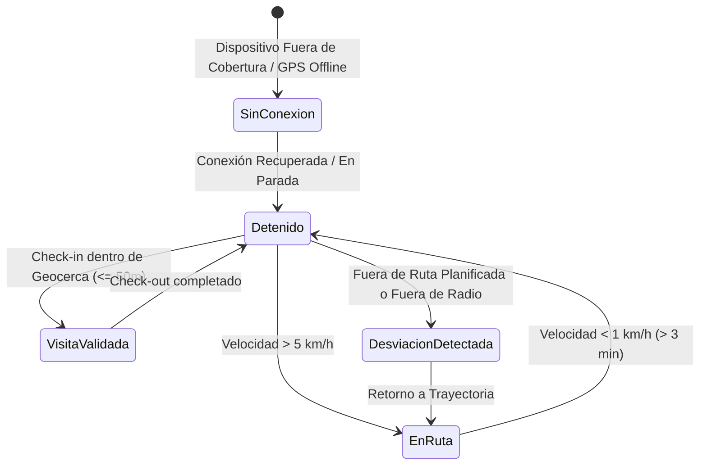
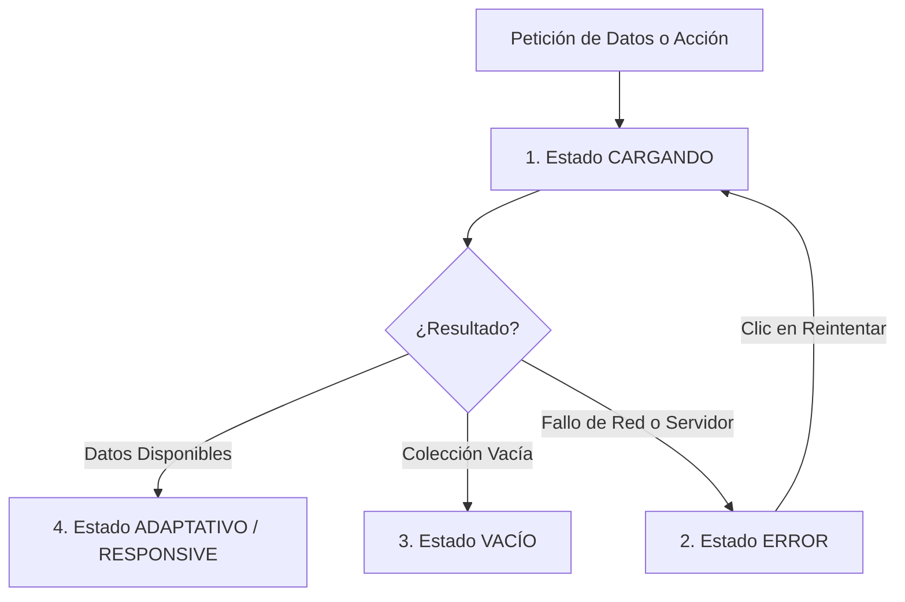

# Sistema de Diseño e Identidad Visual — ROUTRACK

**Proyecto:** ROUTRACK  
**Documento:** Especificación del Sistema de Diseño (Design System)  
**Versión:** 1.0.0  
**Fecha:** Noviembre 2026  
**Estado:** Documento Fundacional Oficial (Aprobado)  
**Autor:** Senior Software Engineer, Cloud/Mobile Solutions Architect & Technical Lead  

---

## 1. Identidad Visual Empresarial

ROUTRACK es una plataforma de misión crítica empresarial destinada a la supervisión operativa, la auditoría forense de desplazamientos comerciales y la optimización de procesos de venta en campo. Su identidad visual debe proyectar:
1. **Precisión y Verosimilitud:** La cartografía, las polilíneas de ruta y los cómputos métricos deben comunicarse sin ambigüedades, empleando tipografías monoespaciadas para coordenadas y números de precisión.
2. **Eficiencia Cognitiva y Sobriedad:** Interfaces limpias, desprovistas de saturación cromática decorativa. Los colores de acento se reservan estrictamente para comunicar estados operativos y alertas de control.
3. **Ergonomía de Campo (App Móvil Android):** Áreas táctiles holgadas (mínimo 48x48 dp), contraste superior para visualización legible bajo luz solar directa en calle y flujos de un solo toque para acciones recurrentes (Check-in, Check-out, Inicio/Cierre de turno).
4. **Comodidad para Supervisión Continua (Panel Web):** Densidad de información equilibrada, soporte de temas oscuros o neutros slate de bajo brillo que eviten la fatiga visual durante jornadas prolongadas de monitoreo.

---

## 2. Paleta de Colores Semántica

La paleta cromática se desacopla en tres familias esenciales y una matriz específica de estados operativos, mapeada tanto para **Tailwind CSS** (Panel Web) como para **Material 3 Tokens** (App Móvil).

### 2.1. Colores Primarios, Secundarios y Neutros

| Categoría | Nombre del Token | HEX | Tailwind Class | Material 3 Token (Compose) | Propósito y Uso |
| :--- | :--- | :--- | :--- | :--- | :--- |
| **Primario** | Primary Navy | `#0F172A` | `slate-900` | `md_theme_primaryContainer` | Barras de navegación superior, fondo de sidebar y títulos principales. |
| **Primario Acción** | Primary Blue | `#2563EB` | `blue-600` | `md_theme_primary` | Botones de acción primordial, enlaces activos y acentos de selección. |
| **Primario Hover** | Primary Blue Dark | `#1D4ED8` | `blue-700` | `md_theme_onPrimary` | Estado interactivo hover/pressed en elementos primarios. |
| **Secundario** | Slate Gray | `#475569` | `slate-600` | `md_theme_secondary` | Etiquetas secundarias, bordes de elementos interactivos secundarios. |
| **Secundario Light**| Slate Subtle | `#F1F5F9` | `slate-100` | `md_theme_secondaryContainer`| Fondos de inputs deshabilitados y separadores sutiles. |
| **Superficie** | Pure White | `#FFFFFF` | `white` | `md_theme_surface` | Fondo de tarjetas (cards), modales y celdas de tabla. |
| **Fondo Global** | Slate Canvas | `#F8FAFC` | `slate-50` | `md_theme_background` | Lienzo de fondo de toda la aplicación web. |
| **Borde Estándar** | Slate Border | `#CBD5E1` | `slate-300` | `md_theme_outline` | Delimitación estructural de tarjetas, inputs y tablas. |

### 2.2. Paleta de Estados Operativos (Obligatoria)

La semántica operativa de ROUTRACK clasifica el estado de la fuerza de ventas en 5 condiciones inequívocas:

| Estado Operativo | Color Representativo | HEX | Tailwind (Web) | Material 3 (Android) | Criterio de Activación en el Sistema |
| :--- | :--- | :--- | :--- | :--- | :--- |
| **En Ruta** | Azul Tránsito | `#2563EB` | `bg-blue-600 text-white` | `colorScheme.primary` | Vendedor con jornada activa, telemetría reportando velocidad > 5 km/h y siguiendo corredor de ruta. |
| **Detenido** | Ámbar Estático | `#D97706` | `bg-amber-600 text-white` | `colorScheme.tertiary` | Vendedor en jornada pero con velocidad < 1 km/h durante más de 3 minutos consecutivos (sin visita activa). |
| **Visita Validada** | Verde Éxito | `#059669` | `bg-emerald-600 text-white` | `colorScheme.secondary` | Check-in ejecutado fehacientemente dentro del radio de geocerca del cliente (`ST_DWithin = TRUE`). |
| **Desviación Detectada** | Rojo Alerta | `#DC2626` | `bg-red-600 text-white` | `colorScheme.error` | Vendedor apartado del corredor de clientes (> 300m), visita registrada fuera de radio o Mock Location activo. |
| **Sin Conexión** | Gris Desconectado | `#64748B` | `bg-slate-500 text-white` | `colorScheme.surfaceVariant` | Más de 15 minutos sin reporte de telemetría o dispositivo en modo avión/sin señal celular. |

---

## 3. Tipografía, Jerarquía Visual y Espaciados

### 3.1. Tipografía y Escala
- **Panel Web (Tailwind):** Familia `Inter, system-ui, -apple-system, sans-serif`. Para valores de telemetría y coordenadas: `JetBrains Mono, Menlo, monospace`.
- **App Móvil (Material 3):** `Roboto` con escala tipográfica estándar de Google Material 3.

| Nivel Tipográfico | Web (Tailwind) | Android (Compose M3) | Peso (Weight) | Uso en Pantalla |
| :--- | :--- | :--- | :--- | :--- |
| **Display Grande** | `text-2xl font-bold` (24px/32px) | `Typography.headlineMedium` (28sp) | Bold (700) | Métricas destacadas en tarjetas KPI del dashboard. |
| **Encabezado H1** | `text-xl font-semibold` (20px/28px)| `Typography.headlineSmall` (24sp) | SemiBold (600) | Títulos de vistas principales (Monitoreo en Vivo, Auditoría). |
| **Encabezado H2** | `text-lg font-medium` (18px/24px) | `Typography.titleLarge` (22sp) | Medium (500) | Títulos de secciones, nombres de clientes y modales. |
| **Cuerpo Regular** | `text-sm font-normal` (14px/20px) | `Typography.bodyMedium` (14sp) | Regular (400) | Contenido de tablas, observaciones comerciales, formularios. |
| **Subtítulo / Muted**| `text-xs font-normal` (12px/16px) | `Typography.bodySmall` (12sp) | Regular (400) | Marcas de tiempo, etiquetas de estado, textos de ayuda. |
| **Monoespaciado** | `font-mono text-xs` (12px/16px) | `Typography.labelSmall` (11sp) | Medium (500) | Coordenadas GPS (`-0.18065, -78.46783`), Hashes HMAC truncados. |

### 3.2. Espaciados y Radios de Borde (Tailwind CSS y Material 3)

| Dimensión | Tailwind Class | Android dp (Material 3) | Aplicación |
| :--- | :--- | :--- | :--- |
| **Micro** | `p-1 / gap-1` (4px) | `4.dp` | Espacio entre icono y texto en badges compactos. |
| **Pequeño** | `p-2 / gap-2` (8px) | `8.dp` | Espacio interno de botones compactos y chips de filtro. |
| **Base** | `p-3 / gap-3` (12px) | `12.dp` | Relleno de celdas de tabla e inputs de formulario. |
| **Medio** | `p-4 / gap-4` (16px) | `16.dp` | Margen de tarjetas operativas y espaciado de grids en móvil. |
| **Grande** | `p-6 / gap-6` (24px) | `24.dp` | Padding de contenedores modales y cabeceras de página. |
| **Radio Control** | `rounded-lg` (8px) | `ShapeDefaults.Small` (8.dp) | Botones, cajas de texto (`OutlinedTextField`), selects. |
| **Radio Tarjeta** | `rounded-xl` (12px) | `ShapeDefaults.Medium` (12.dp)| Tarjetas KPI, contenedores de mapa y paneles laterales. |
| **Radio Píldora** | `rounded-full` (9999px) | `CircleShape` | Badges de estados operativos, avatars de usuario. |

---

## 4. Componentes Base del Sistema

### 4.1. Botones (Action Buttons)
- **Primary:** `bg-blue-600 hover:bg-blue-700 text-white font-medium px-4 py-2 rounded-lg shadow-sm active:scale-[0.98] transition-all`. En Android: `Button(colors = ButtonDefaults.buttonColors(containerColor = PrimaryBlue))`.
- **Secondary / Outlined:** `bg-white hover:bg-slate-50 text-slate-700 border border-slate-300 font-medium px-4 py-2 rounded-lg`. En Android: `OutlinedButton`.
- **Critical Action:** `bg-red-600 hover:bg-red-700 text-white font-medium px-4 py-2 rounded-lg`. Utilizado exclusivamente para "Abortar Turno" o "Revocar Acceso".

### 4.2. Tarjetas de Métricas (KPI Cards)
Contenedor modular con fondo blanco, borde perimetral en `slate-200` y sombra sutil `shadow-sm`:
- Icono en esquina superior derecha con fondo semántico suave (ej. icono de camión con fondo `blue-50`).
- Etiqueta descriptiva en `text-xs text-slate-500 uppercase tracking-wider`.
- Valor numérico de gran tamaño en `text-2xl font-bold text-slate-900`.
- Indicador comparativo o de tendencia en la base (ej. "+12% respecto a la jornada anterior").

### 4.3. Visor de Mapas Interactivo (Leaflet con OpenStreetMap)
- Contenedor con borde redondeado `rounded-xl overflow-hidden border border-slate-200`.
- Capa base de teselas: OpenStreetMap Standard (`https://{s}.tile.openstreetmap.org/{z}/{x}/{y}.png`).
- **Marcadores Personalizados:**
  - *Vendedor Activo:* Marcador SVG circular pulsante con flecha de orientación (*bearing*). Color azul si está en movimiento, ámbar si está detenido.
  - *Cliente Visitado:* Pin esmeralda con check central.
  - *Cliente Pendiente:* Pin pizarra neutro con inicial del cliente.
  - *Desviación / Alerta:* Círculo rojo semitransparente que resalta la zona de la anomalía.
- **Polilínea de Recorrido:** Trazo en azul semiopaco (`#2563EB`, opacidad 0.8, grosor 4px) conectando la secuencia de puntos GPS ordenados por `recorded_at`.

### 4.4. Tablas de Auditoría e Historial
- **Cabecera Fija:** `bg-slate-50 text-slate-700 text-xs font-semibold uppercase tracking-wider border-b border-slate-200`.
- **Filas Alternadas:** Filas con efecto hover suave `hover:bg-slate-50/80 transition-colors`.
- **Celdas de Identidad y Hashes:** Tipografía monoespaciada para IDs y hashes truncados con botón de copiado rápido al portapapeles.

---

## 5. Especificación Obligatoria de los 4 Estados de Interfaz

Toda vista del panel web y pantalla de la aplicación Android debe implementar sin excepción los siguientes cuatro estados:

### 5.1. Estado Cargando (Loading State)
- **Web:** Prohibido el bloqueo de pantalla completa con spinners opacos sin contexto. Se emplean **Skeleton Loaders** que replican la anatomía exacta del contenido a desplegar (rectángulos redondeados con pulso `animate-pulse bg-slate-200`). Para el mapa Leaflet, se despliega una cuadrícula gris tenue con un indicador central "Cargando telemetría geoespacial...".
- **Android (Compose):** Uso de modificador `Modifier.placeholder(visible = true, highlight = PlaceholderHighlight.shimmer())` en tarjetas de visita y cabeceras de jornada.

### 5.2. Estado Error (Error State)
- **Directriz:** Todo error debe ser comprensible para el usuario, formulado en español claro y accionable, **proveyendo siempre un botón explícito de reintento**.
- **Web:** Banner o tarjeta centrada con borde lateral izquierdo rojo pronunciado (`border-l-4 border-red-500 bg-red-50 p-4 rounded-r-lg`).
  - *Título:* "No fue posible sincronizar las rutas del día".
  - *Detalle técnico accesible:* "Código de respuesta 503 / Timeout de conexión con Supabase".
  - *Acción:* Botón `Reintentar Conexión` que ejecuta una revalidación manual sin refrescar toda la página web.
- **Android:** Snackbar persistente con botón `REINTENTAR` en caso de fallos transitorios, o diálogo modal con diagnóstico de GPS apagado solicitando al usuario encender el sensor de ubicación en los ajustes del sistema.

### 5.3. Estado Vacío (Empty State)
- **Directriz:** Ninguna pantalla debe quedar en blanco cuando una consulta devuelve cero registros. Debe educar y orientar al usuario sobre el flujo de trabajo.
- **Componentes:**
  1. Icono ilustrativo lineal neutro en `slate-400` (tamaño 64x64 px).
  2. Título explicativo directo (ej. "No hay vendedores en ruta en este momento").
  3. Texto secundario orientador (ej. "Los asesores comerciales que inicien turno laboral desde su app Android aparecerán georreferenciados automáticamente en este mapa").
  4. Botón de acción opcional (ej. "Ver Jornadas de Días Anteriores" o "Crear Nuevo Cliente").

### 5.4. Estado Adaptativo y Responsive (Responsive Design)
La interfaz debe reorganizarse de manera armónica en tres rupturas (*breakpoints*) esenciales:

1. **Escritorio Panorámico ($\ge 1280\text{ px}$):**
   - Vista en pantalla dividida (Split-View): panel lateral de lista de vendedores y filtros a la izquierda (380px de ancho fijo), con visor de mapa Leaflet ocupando el 100% del área restante.
2. **Tableta / Portátil Compacto ($768\text{ px} - 1279\text{ px}$):**
   - Barra de navegación lateral colapsable a iconos mínimos (64px). La lista de vendedores pasa a ser un cajón inferior deslizable (*Bottom Sheet*) que se superpone al mapa interactivo.
3. **Móvil / Pantallas Angostas ($< 768\text{ px}$):**
   - Panel Web: Alternancia mediante selector de pestañas fijas (`[ Ver Lista ]` | `[ Ver Mapa ]`) para garantizar que el mapa disponga de área táctil suficiente.
   - App Móvil Android: Navegación inferior persistente (`NavigationBar` de Compose) con áreas de pulsación táctil optimizadas para operación con una sola mano en campo.
