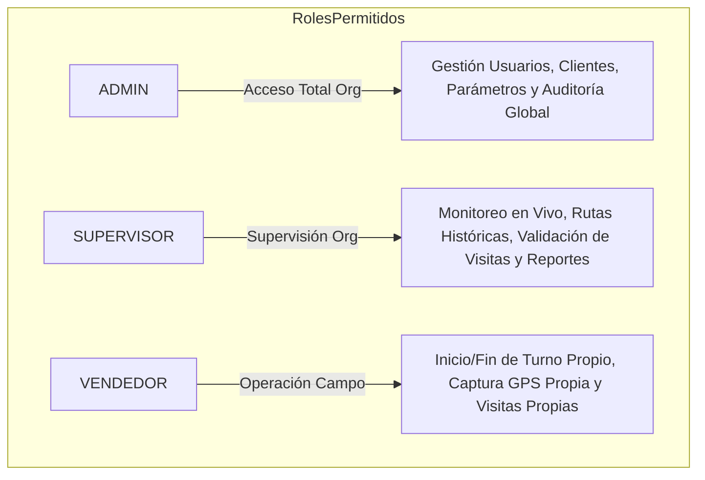
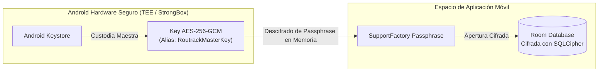
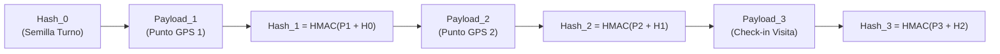

# Arquitectura de Seguridad, Criptografía y Privacidad — ROUTRACK

**Proyecto:** ROUTRACK  
**Documento:** Política de Seguridad, Privacidad de Datos y Cumplimiento Normativo  
**Versión:** 1.0.0  
**Fecha:** Noviembre 2026  
**Estado:** Documento Fundacional Oficial (Aprobado)  
**Autor:** Senior Software Engineer, Cloud/Mobile Solutions Architect & Technical Lead  

---

## 1. Modelo de Amenazas (STRIDE)

Para salvaguardar la plataforma y los datos de localización de los empleados, ROUTRACK implementa un modelo de análisis de amenazas basado en la metodología **STRIDE**:

| Categoría de Amenaza | Riesgo Identificado en ROUTRACK | Contramedida de Seguridad Aplicada |
| :--- | :--- | :--- |
| **Spoofing (Suplantación)** | Un vendedor intenta simular check-ins o telemetría falsificando credenciales o inyectando coordenadas falsas (*Fake GPS*). | Supabase Auth con tokens JWT firmados criptográficamente; detección en Android de proveedores de ubicación simulada (`Location.isFromMockProvider` / `isMock`). |
| **Tampering (Manipulación)** | Modificación manual del historial de puntos GPS en la base de datos local SQLite o en tránsito para encubrir desvíos. | Base de datos Room cifrada con SQLCipher (AES-256-GCM); cadena de custodia matemática con **HMAC-SHA256 encadenado** en cada punto y evento. |
| **Repudiation (Repudio)** | Un vendedor o supervisor niega haber registrado un check-in de visita o haber alterado la configuración de un cliente. | Bitácora inmutable en `audit_logs` con permisos estrictos de `INSERT ONLY` protegida con firmas criptográficas no repudiables. |
| **Information Disclosure (Fuga de Información)** | Acceso no autorizado de una empresa a los datos de ruta, clientes o precios pactados de un competidor en la misma base de datos. | Aislamiento multi-tenant forzado en el 100% de tablas mediante **Row Level Security (RLS)**; comunicaciones 100% cifradas bajo TLS 1.3. |
| **Denial of Service (Denegación de Servicio)** | Saturación del backend mediante inundación de paquetes GPS individuales desde dispositivos móviles. | Ingesta por lotes (*batching*) en WorkManager; limitación de tasa (*rate limiting*) en Supabase Edge Functions. |
| **Elevation of Privilege (Elevación de Privilegios)** | Un vendedor manipula tokens de sesión para actuar como supervisor y aprobar visitas fuera de radio. | Validación de claims de rol en JWT evaluados directamente por el motor de PostgreSQL a través de políticas RLS inalterables desde el cliente. |

---

## 2. Autenticación y Autorización Basada en Roles (RBAC)

### 2.1. Autenticación JWT vía Supabase Auth
- Toda interacción con la plataforma requiere autenticación previa mediante correo electrónico corporativo y contraseña con estándar NIST (mínimo 10 caracteres, combinando alfanuméricos y símbolos).
- **Tokens de Sesión:**
  - `access_token`: Token JWT de corta duración (60 minutos), firmado con secreto criptográfico HMAC-SHA256 en Supabase Auth.
  - `refresh_token`: Token de larga duración para renovación automática, almacenado en el hardware seguro del dispositivo Android o en cookies `HttpOnly` y `SameSite=Lax` en el panel web.

### 2.2. Matriz de Roles (RBAC)
Los tres roles del sistema están estrictamente delimitados:



| Funcionalidad / Entidad | Rol VENDEDOR | Rol SUPERVISOR | Rol ADMIN |
| :--- | :---: | :---: | :---: |
| Iniciar / Cerrar Turno Propio | **Sí** | No | No |
| Registrar Telemetría GPS Propia | **Sí** | No | No |
| Registrar Visita Comercial Propia | **Sí** | No | No |
| Ver Mapa de Monitoreo en Vivo | No | **Sí** (su organización) | **Sí** (su organización) |
| Consultar Histórico de Rutas | No | **Sí** (su organización) | **Sí** (su organización) |
| Administrar Clientes y Geocercas | No | Solo Lectura | **Sí** (CRUD completo) |
| Administrar Perfiles y Vendedores | No | No | **Sí** (su organización) |
| Consultar Bitácora de Auditoría | No | Solo Lectura Operativa | **Sí** (Auditoría Forense) |

---

## 3. Políticas Estrictas de Row Level Security (RLS)

Todas las tablas en PostgreSQL tienen el mecanismo RLS forzado (`ALTER TABLE ... ENABLE ROW LEVEL SECURITY;`). La regla inquebrantable de aislamiento establece que **ninguna fila puede ser consultada, insertada o modificada fuera de la organización del usuario autenticado**.

### 3.1. Funciones Auxiliares de Contexto de Seguridad
```sql
-- Extraer el organization_id del token JWT
CREATE OR REPLACE FUNCTION auth.jwt_organization_id()
RETURNS UUID AS $$
  SELECT NULLIF(current_setting('request.jwt.claims', true)::jsonb -> 'app_metadata' ->> 'organization_id', '')::UUID;
$$ LANGUAGE SQL STABLE;

-- Extraer el rol del token JWT
CREATE OR REPLACE FUNCTION auth.jwt_role()
RETURNS TEXT AS $$
  SELECT NULLIF(current_setting('request.jwt.claims', true)::jsonb -> 'app_metadata' ->> 'role', '');
$$ LANGUAGE SQL STABLE;
```

### 3.2. Políticas por Entidad (Aislamiento y Roles)

```sql
-- 1. Tabla clients: Solo miembros de la misma organización pueden consultar
CREATE POLICY "RLS_clients_select" ON public.clients
FOR SELECT USING (organization_id = auth.jwt_organization_id());

CREATE POLICY "RLS_clients_admin_mutate" ON public.clients
FOR ALL USING (
  organization_id = auth.jwt_organization_id() AND
  auth.jwt_role() = 'ADMIN'
);

-- 2. Tabla work_shifts: Vendedores solo gestionan sus turnos; Supervisores y Admins leen todos
CREATE POLICY "RLS_shifts_vendedor" ON public.work_shifts
FOR ALL USING (
  organization_id = auth.jwt_organization_id() AND
  seller_id = auth.uid()
);

CREATE POLICY "RLS_shifts_supervision_select" ON public.work_shifts
FOR SELECT USING (
  organization_id = auth.jwt_organization_id() AND
  auth.jwt_role() IN ('SUPERVISOR', 'ADMIN')
);

-- 3. Tabla tracking_points: Vendedor inserta; supervisión consulta
CREATE POLICY "RLS_tracking_vendedor_insert" ON public.tracking_points
FOR INSERT WITH CHECK (
  organization_id = auth.jwt_organization_id() AND
  seller_id = auth.uid()
);

CREATE POLICY "RLS_tracking_supervision_select" ON public.tracking_points
FOR SELECT USING (
  organization_id = auth.jwt_organization_id() AND
  auth.jwt_role() IN ('SUPERVISOR', 'ADMIN')
);

-- 4. Tabla audit_logs: SOLO INSERCIÓN. Modificación y eliminación bloqueadas universalmente
CREATE POLICY "RLS_audit_insert_only" ON public.audit_logs
FOR INSERT WITH CHECK (organization_id = auth.jwt_organization_id());

CREATE POLICY "RLS_audit_select" ON public.audit_logs
FOR SELECT USING (
  organization_id = auth.jwt_organization_id() AND
  auth.jwt_role() = 'ADMIN'
);
```

---

## 4. Prohibición Absoluta de Exposición de la `service_role_key`

1. **Clave Anónima (`anon key`):** Es la única clave autorizada para incluirse en el bundle del panel web o en la app móvil. Opera sujeta al 100% a las políticas RLS.
2. **Clave de Rol de Servicio (`service_role_key`):**
   - Esta clave omite todas las políticas de seguridad RLS de PostgreSQL.
   - **Prohibición Terminante:** Queda estrictamente vetado incorporar la `SUPABASE_SERVICE_ROLE_KEY` en `web-admin` (ni en variables `NEXT_PUBLIC_*` ni en Server Components accesibles al usuario), en `mobile-android` o en repositorios de control de versiones.
   - Su empleo queda confinado exclusivamente al entorno de ejecución privado de migraciones de base de datos o en Supabase Edge Functions con autenticación restringida.

---

## 5. Cifrado Local en Reposo en Android (Keystore + SQLCipher)

La base de datos local del vendedor almacena información sensible de trayectorias y acuerdos comerciales. Para blindarla contra ataques físicos o extracción indebida de archivos:



1. **Generación de Clave en Hardware Seguro:**
   - La aplicación genera un par de claves o clave secreta en el **Android Keystore System** bajo el alias `RoutrackMasterKey`.
   - Parámetros: `KeyProperties.KEY_ALGORITHM_AES`, `KeyProperties.BLOCK_MODE_GCM`, `KeyProperties.ENCRYPTION_PADDING_NONE`, tamaño de clave de 256 bits (`PURPOSE_ENCRYPT | PURPOSE_DECRYPT`).
2. **Cifrado de Base de Datos con SQLCipher:**
   - La base de datos SQLite gestionada por Room no se almacena en texto plano. Se integra con **SQLCipher** mediante `net.zetetic.database.sqlcipher.SupportFactory`.
   - La frase de paso (*passphrase*) de cifrado se genera aleatoriamente en el primer inicio de la app, se cifra mediante la llave maestra de Keystore y se guarda en `EncryptedSharedPreferences`.

---

## 6. Algoritmo de Integridad y Hash Chaining (Cadena de Custodia)

Para impedir la alteración o inyección retrospectiva de coordenadas GPS o registros de visitas por parte de usuarios o agentes maliciosos, ROUTRACK implementa un algoritmo de **encadenamiento criptográfico HMAC-SHA256**:

### 6.1. Definición Matemática
Sea $Payload_n$ la representación canónica serializada en JSON del registro $n$, sea $Hash_{n-1}$ el hash del registro precedente en la jornada, y sea $K$ la clave criptográfica secreta de sesión del vendedor:

$$Hash_0 = \text{HMAC-SHA256}(\text{"ROUTRACK-SHIFT-INIT"} \parallel ShiftID, K)$$

$$Hash_n = \text{HMAC-SHA256}(Payload_n \parallel Hash_{n-1}, K) \quad \text{para } n \ge 1$$



### 6.2. Verificación en Backend
Al recibir el lote en la Edge Function `sync-jornada`, el servidor recalcula de forma secuencial la cadena de hashes. Si un solo byte del payload o del orden temporal fue alterado, se rechaza la transacción con código `HMAC_CHAIN_TAMPERED` y se registra una alerta inmediata en `audit_logs`.

---

## 7. Cumplimiento Normativo y Privacidad Laboral (LOPDP Ecuador)

El diseño de ROUTRACK está rigurosamente alineado con la **Ley Orgánica de Protección de Datos Personales (LOPDP)** de la República del Ecuador para el tratamiento de datos de geolocalización de empleados:

### 7.1. Principio de Finalidad y Proporcionalidad (Art. 10 LOPDP)
- La recolección de coordenadas GPS tiene como finalidad única y legítima:
  1. Optimizar la logística y asignación de clientes.
  2. Verificar la ejecución presencial de visitas comerciales en puntos de venta.
  3. Velar por la seguridad del trabajador en caso de emergencias en ruta.
- No se recolectan datos innecesarios ni se efectúa inferencia de perfiles personales ajenos a la actividad laboral.

### 7.2. Seguimiento Transparente y Confinado a la Jornada Formal
- **Notificación Persistente Obligatoria:** Durante todo el lapso de rastreo, Android muestra una notificación fija no descartable: *"ROUTRACK en servicio — Registrando ruta de jornada laboral"*.
- **Límite Temporal Infranqueable:** La recolección se inicia únicamente con el clic voluntario de "Iniciar Jornada" y cesa en el milisegundo exacto en que el vendedor pulsa "Finalizar Jornada".
- **Sin Monitoreo en Descansos:** La app no recolecta coordenadas en horas de almuerzo, fines de semana ni periodos de descanso.

### 7.3. Prohibición Absoluta de Vigilancia Invasiva
Queda formalmente vetado e impedido en el código:
- **Cero Keyloggers:** No se capturan pulsaciones de teclado ni contraseñas.
- **Cero Acceso a Mensajería:** Ninguna lectura de WhatsApp, SMS ni correos personales.
- **Cero Inspección Externa:** Prohibido sondear qué aplicaciones tiene instaladas o abiertas el trabajador en su teléfono.
- **Cero Activación Oculta:** Prohibida la activación silenciosa de micrófonos, cámaras o captura de pantalla.

### 7.4. Política de Retención y Purgado
- La telemetría detallada minuto a minuto (`tracking_points`) se conserva por un plazo máximo de **180 días**, tras el cual se anonimiza y purga de la base de datos, consolidándose únicamente en métricas agregadas de kilometraje total y visitas comerciales verificadas.
