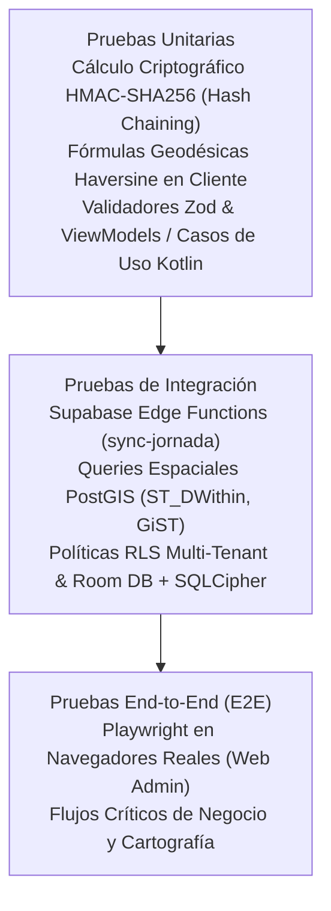
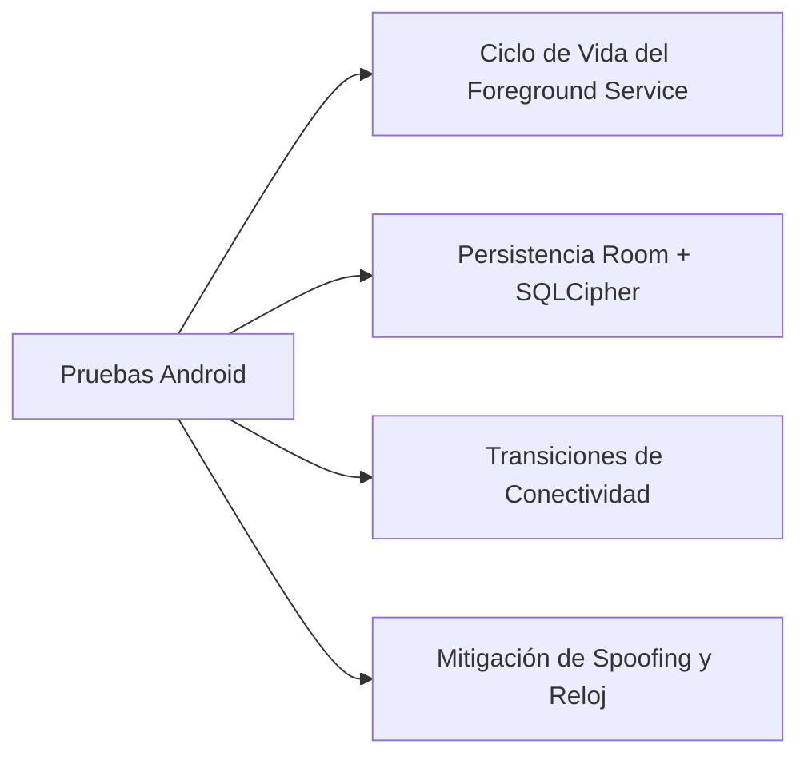
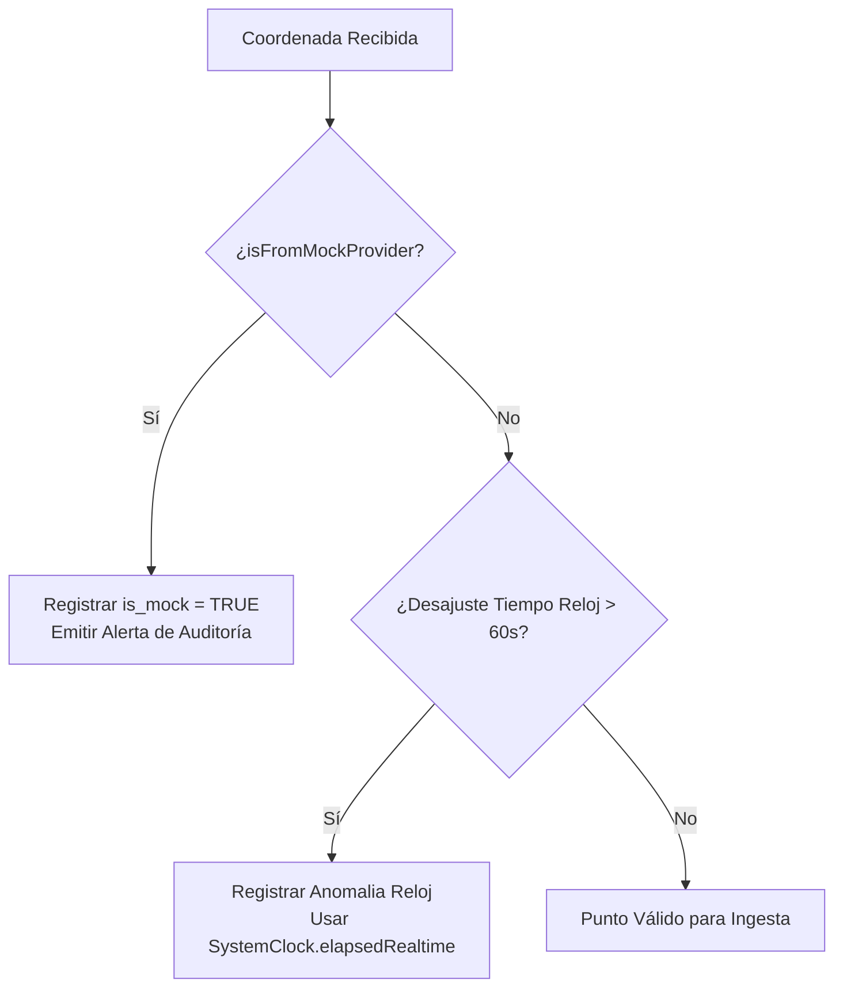

# Plan Integral de Pruebas y Aseguramiento de Calidad — ROUTRACK

**Proyecto:** ROUTRACK  
**Documento:** Plan de Pruebas (Test Plan) y Criterios de Aceptación  
**Versión:** 1.0.0  
**Fecha:** Noviembre 2026  
**Estado:** Documento Fundacional Oficial (Aprobado)  
**Autor:** Senior Software Engineer, Cloud/Mobile Solutions Architect & Technical Lead  

---

## 1. Estrategia de Pruebas en Pirámide

La confiabilidad operativa de ROUTRACK se fundamenta en una **pirámide de pruebas adaptada a ecosistemas móviles y cloud geoespaciales**. Cada estrato tiene un objetivo de verificación aislado y riguroso:

---

## 2. Estratos de la Pirámide de Pruebas

### 2.1. Pruebas Unitarias

#### 2.1.1. Verificación Criptográfica y Cadena de Custodia (HMAC-SHA256)
- **Objetivo:** Garantizar que el cálculo del hash encadenado sea determinista, reproducible y seguro ante cualquier mutación de un solo bit en la carga útil.
- **Alcance:**
  - Pruebas en Kotlin para `HmacChainSigner.kt` y en TypeScript para `verify-hmac.ts` en la Edge Function.
  - Caso de prueba de consistencia: Dado un payload $P_1$ y hash previo $H_0$, el resultado $H_1 = \text{HMAC}(P_1 + H_0, K)$ debe ser idéntico en Android y en Deno.
  - Caso de prueba de anti-manipulación: Alterar un solo carácter en las notas de la visita debe romper de inmediato la validación de la firma en la Edge Function.

#### 2.1.2. Lógica de Dominio y Validación de Esquemas (Zod / Kotlin Domain)
- **Alcance:**
  - Validación de esquemas Zod en `web-admin` y `supabase/functions`: coordenadas de latitud en rango $[-90, 90]$, longitud en $[-180, 180]$, radio de geocerca $> 0$, y formato de identificación fiscal (RUC ecuatoriano de 13 dígitos numéricos).
  - Casos de uso de inicio y cierre de jornada laboral en Android, asegurando que no se pueda iniciar un turno si ya existe uno con estado `OPEN`.

---

### 2.2. Pruebas de Integración

#### 2.2.1. Consultas Espaciales en PostGIS y Rendimiento GiST
- **Herramientas:** pgTAP / scripts Node.js contra instancia local de Supabase (`supabase test db`).
- **Casos de Prueba:**
  1. **Precisión de Geocerca con `ST_DWithin`:**
     - Punto a 48 metros de las coordenadas del cliente $\rightarrow$ clasificado como `VERIFIED`.
     - Punto a 52 metros de las coordenadas del cliente (radio de 50m) $\rightarrow$ clasificado como `OUT_OF_RANGE`.
  2. **Detección de Desvíos de Ruta:**
     - Simulación de un corredor de clientes a lo largo de una avenida. Inserción de un punto a 400m del trazado $\rightarrow$ identificado correctamente por la consulta de desvío espacial.
  3. **Rendimiento de Índices GiST:**
     - Verificación del plan de ejecución (`EXPLAIN ANALYZE`) comprobando que las consultas de proximidad ejecutan un *Index Scan* sobre `idx_clients_location` y no un *Seq Scan*.

#### 2.2.2. Aislamiento Multi-Tenant con Row Level Security (RLS)
- **Casos Obligatorios:**
  1. Un token JWT perteneciente a `Empresa A` intenta consultar registros de `Empresa B` en `clients`, `work_shifts` o `tracking_points`. La base de datos debe devolver 0 filas.
  2. Un usuario con rol `VENDEDOR` intenta modificar un registro de `audit_logs` o actualizar el perfil de otro vendedor. La operación debe ser denegada con error de permisos RLS.

#### 2.2.3. Edge Function `sync-jornada`
- Enviar un lote de 50 puntos de telemetría y 2 visitas en formato JSON.
- Comprobar que la respuesta retorne HTTP 200 con el resumen de filas persistidas.
- Reenviar el mismo lote exactamente: comprobar que el servidor responda HTTP 200 reportando filas ignoradas por conflicto (`tracking_points_ignored_conflict = 50`) sin generar duplicados.

---

### 2.3. Pruebas End-to-End (E2E) con Playwright

Las pruebas E2E automatizan los flujos de usuario completos sobre navegadores reales en `web-admin`:

| ID de Prueba | Flujo de Negocio Evaluado | Condición de Aprobación |
| :--- | :--- | :--- |
| **E2E-01** | Autenticación y Control de Acceso | Login exitoso redirige a `/live`; login fallido muestra banner de error; rutas protegidas bloquean navegación anónima. |
| **E2E-02** | Visor de Monitoreo en Vivo | El mapa interactivo Leaflet carga teselas OSM, renderiza los marcadores de vendedores activos y abre popups con datos operativos al hacer clic. |
| **E2E-03** | Análisis Histórico de Recorrido | Selección de vendedor y fecha; renderizado de la polilínea continua y visualización de la lista de visitas comerciales asociadas. |
| **E2E-04** | Creación y Georreferenciación de Cliente | Formulario de nuevo cliente con selección de coordenadas en mapa; persistencia exitosa reflejada en el directorio. |
| **E2E-05** | Auditoría y Exportación de Reporte | Filtrado de jornadas del día y descarga de archivo CSV, validando que el archivo contenga cabeceras UTF-8 BOM y datos correctos. |

---

## 3. Pruebas Especializadas para Android Nativo

Dadas las restricciones de hardware y sistema operativo, el módulo móvil `mobile-android` se somete a validaciones especializadas:

### 3.1. Ciclo de Vida del Foreground Service
- **Persistencia bajo Presión de Memoria:** Simulación de estrés de RAM mediante comandos ADB (`am send-trim-memory com.routrack.mobile COMPLETE`). El `TrackingForegroundService` debe permanecer activo sin ser terminado por el sistema.
- **Notificación Obligatoria:** Verificación de que la notificación persistente permanezca visible en la barra de estado con la etiqueta obligatoria de seguimiento mientras el turno esté abierto.
- **Destrucción Inmediata:** Al invocar el caso de uso `FinalizarJornada`, comprobar que el servicio invoque `stopForeground(STOP_FOREGROUND_REMOVE)` y `stopSelf()`, liberando inmediatamente todos los listeners del GPS.

### 3.2. Almacenamiento Room Cifrado con SQLCipher
- Inicialización de `Room.databaseBuilder` integrando `SupportFactory(masterKeyPassphrase)`.
- Verificación empírica de cifrado: Extraer el archivo `.db` del dispositivo mediante ADB e intentar abrirlo con un visor SQLite genérico; el archivo debe ser ilegible (`file is not a database`).

### 3.3. Transiciones de Conectividad (Offline $\rightarrow$ Online Batch Flush)
1. Iniciar jornada en dispositivo físico o emulador.
2. Activar "Modo Avión" mediante ADB (`adb shell cmd connectivity airplane-mode enable`).
3. Simular la captura de 40 puntos GPS y 2 visitas en terreno. Todos los registros deben almacenarse en Room con estado `PENDING`.
4. Desactivar "Modo Avión".
5. WorkManager debe disparar automáticamente el `SyncJornadaWorker` bajo la restricción `NetworkType.CONNECTED`.
6. Validar que la totalidad de los 42 registros se transmitan a la Edge Function de Supabase y pasen al estado `SYNCED` localmente sin intervención del usuario.

### 3.4. Mitigación de Spoofing Horario y Mock Locations

1. **Detección de Ubicación Simulada (*Mock Location*):**
   - Ejecución de pruebas con aplicaciones de Fake GPS en dispositivos con "Opciones de Desarrollador" habilitadas.
   - La aplicación debe inspeccionar `location.isFromMockProvider()` (en API < 31) o `location.isMock()` (en API 31+). Todo punto simulado debe persistirse con la bandera `is_mock = true` y generar un evento crítico en `audit_logs`.
2. **Mitigación de Spoofing Horario (Alteración de Fecha/Hora Local):**
   - Si un vendedor adelanta o atrasa manualmente el reloj de su teléfono para simular visitas a horas indebidas, el sistema debe contrastar `System.currentTimeMillis()` contra `SystemClock.elapsedRealtime()` (tiempo transcurrido desde el encendido del hardware, inmune a cambios del reloj del sistema) y con la marca de tiempo de red satelital GPS (`location.time`).
   - Si se detecta una desviación superior a 60 segundos entre el reloj local y la hora de red/satelital, se etiqueta la anomalía en el payload y se ajusta la marca temporal basada en el tiempo monotónico del sistema.

---

## 4. Matriz de Aceptación y Definición de Terminado (DoD)

Para declarar formalmente completada cualquier tarea del plan de trabajo (`TASKS.md`), deben satisfacerse el 100% de las siguientes condiciones:

| Criterio | Estándar Exigido | Método de Validación |
| :--- | :--- | :--- |
| **Apego al Alcance** | Cero código o funcionalidades no especificadas en el PRD. | Revisión de código y diff de Git. |
| **Tipado Estricto Web** | Cero errores de compilación con TypeScript estricto (`strict: true`). Cero uso de `any`. | Ejecución exitosa de `npx tsc --noEmit`. |
| **Calidad de Código Android** | Compilación limpia sin advertencias de Gradle en Kotlin. | Ejecución de `./gradlew assembleDebug test`. |
| **Seguridad de Secretos** | Ninguna clave privada, contraseña ni `SUPABASE_SERVICE_ROLE_KEY` en commits o clientes. | Análisis estático de strings y escaneo de git staged. |
| **Aislamiento RLS** | Toda tabla creada o alterada cuenta con políticas RLS obligatorias. | Verificación en migraciones SQL y tests de integración. |
| **Pruebas Automatizadas** | Pruebas unitarias o de integración escritas y pasando exitosamente. | Ejecución del runner de pruebas correspondiente. |
| **Sincronización Documental**| `TASKS.md` y `docs/MEMORY.md` actualizados inmediatamente tras la verificación. | Comprobación de casillas `[x]` y fechas en documentos. |
