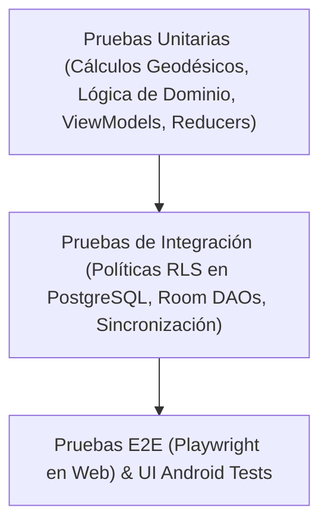

# Plan Integral de Pruebas y Aseguramiento de Calidad — ROUTRACK

**Proyecto:** ROUTRACK  
**Documento:** Plan de Pruebas (Test Plan) y Criterios de Aceptación  
**Versión:** 1.0.0  
**Fecha:** Noviembre 2026  
**Estado:** Base Oficial  

---

## 1. Estrategia General de Pruebas

La calidad de ROUTRACK se asegura mediante una estrategia de **pirámide de pruebas adaptada a ecosistemas híbridos (Web + Mobile + BaaS)**. Dado que la plataforma opera con datos geoespaciales críticos, telemetría continua y sincronización offline, cada capa del sistema debe validarse de forma aislada y en conjunto:

---

## 2. Pruebas Unitarias

### 2.1. Panel Web (Next.js / TypeScript)
- **Herramientas:** Vitest o Jest + React Testing Library.
- **Alcance:**
  - Funciones puras de cálculo geográfico (conversión de formatos de coordenadas, cálculo de distancias aproximadas en el cliente).
  - Transformadores de datos de telemetría para el renderizado de mapas Leaflet (generación de polilíneas, filtros de velocidad).
  - Validadores de esquemas de formularios con Zod (validación de datos de clientes, coordenadas válidas entre -90/90 y -180/180).
  - Formateadores de fecha, hora y métricas de kilometraje/batería.

### 2.2. Aplicación Móvil Android (Kotlin)
- **Herramientas:** JUnit 5, MockK, Coroutines Test (`kotlinx-coroutines-test`), Turbine (para testing de Flows).
- **Alcance:**
  - ViewModels y máquinas de estado de UI (`ShiftViewModel`, `VisitViewModel`).
  - Lógica de cálculo local de proximidad a clientes mediante fórmula de Haversine.
  - Mapeadores entre entidades de Room (`LocalTrackingPointEntity`) y modelos de dominio / DTOs de red.
  - Lógica de detección de Mock Location y proveedores simulados.

---

## 3. Pruebas de Integración

### 3.1. Backend Supabase y Políticas RLS
- **Herramientas:** Supabase CLI local + pgTAP / scripts de prueba con `@supabase/supabase-js`.
- **Casos Obligatorios:**
  - **Aislamiento Multi-Tenant:** Verificar que un token JWT perteneciente a la Organización A reciba cero filas al consultar `clients`, `work_shifts` o `tracking_points` pertenecientes a la Organización B.
  - **Restricción de Rol de Vendedor:** Verificar que un usuario con rol `seller` solo pueda insertar y consultar sus propios `tracking_points` y `work_shifts`, y que no pueda modificar registros de auditoría ni alterar perfiles de otros vendedores.
  - **Permisos de Supervisor:** Validar que un supervisor pueda consultar los vendedores y visitas de su organización pero no pueda alterar registros de organizaciones ajenas.
  - **Cálculo Espacial en PostGIS:** Validar que la función espacial de proximidad devuelva distancias en metros idénticas a los valores de referencia geodésica.

### 3.2. Base de Datos Local Android (Room)
- **Herramientas:** Room In-Memory Database (`Room.inMemoryDatabaseBuilder`).
- **Casos Obligatorios:**
  - Inserción y recuperación cronológica de lotes de puntos GPS.
  - Actualización atómica de estados de sincronización (`pending` -> `synced`).
  - Eliminación segura de puntos antiguos (retención de 7 días).

---

## 4. Pruebas End-to-End (E2E) con Playwright

Las pruebas E2E automatizan los flujos de usuario completos en el panel web sobre navegadores reales (Chromium, Firefox, WebKit):

| ID Prueba | Flujo E2E | Criterio de Éxito |
| :--- | :--- | :--- |
| **E2E-01** | Inicio de sesión válido e inválido | Acceso concedido redirigiendo a dashboard con token válido; mensaje de error claro ante credenciales erróneas. |
| **E2E-02** | Filtrado y visualización de mapa | Al seleccionar un vendedor activo, el mapa centra su posición y dibuja el marcador con los metadatos correctos. |
| **E2E-03** | Trazado histórico de recorrido | Al escoger una fecha pasada y un vendedor, se carga la polilínea completa en el mapa con los marcadores de parada y visitas. |
| **E2E-04** | Creación y georreferenciación de cliente | Creación de cliente con formulario y selección en mapa; persistencia verificada y visible en la lista. |
| **E2E-05** | Exportación de reporte | Descarga de archivo CSV de jornada conteniendo las columnas requeridas (fecha, vendedor, kilómetros, visitas totales, verificadas). |

---

## 5. Pruebas Específicas de Android

### 5.1. Ciclo de Vida del Foreground Service
- Comprobar que al iniciar la jornada se invoque `startForegroundService` y se enlace una notificación persistente de prioridad `IMPORTANCE_LOW` o `IMPORTANCE_DEFAULT`.
- Verificar que la app no sea eliminada por el sistema ante escenarios de baja memoria (simulación de *Low Memory Killer* con `am send-trim-memory`).
- Validar que al pulsar "Finalizar Jornada", el servicio se detenga de forma limpia y la notificación desaparezca de inmediato.

### 5.2. Pruebas de Interfaz Móvil (Compose UI)
- Pruebas automatizadas de renderizado de pantallas con `createComposeRule`.
- Verificación de botones grandes accesibles para interacción rápida en campo.
- Diálogo de confirmación obligatorio antes de finalizar jornada para evitar cierres accidentales.

---

## 6. Pruebas de Sincronización y Conectividad (Offline-First)

Este conjunto de pruebas garantiza que ROUTRACK soporte las condiciones de campo más adversas:

1. **Simulación de Modo Avión (Offline Prolongado):**
   - Se inicia jornada en el dispositivo móvil y se activa el Modo Avión.
   - Se simulan 100 actualizaciones de ubicación y el registro de 3 visitas comerciales.
   - **Validación:** Los 103 registros deben encontrarse almacenados en SQLite/Room con `sync_status = 'pending'`. La UI debe seguir funcionando normalmente sin bloqueos.
2. **Reconexión y Descarga de Lote:**
   - Se desactiva el Modo Avión restaurando la conexión Wi-Fi/móvil.
   - WorkManager detecta conectividad y ejecuta el `SyncWorker`.
   - **Validación:** Los 103 registros se envían a Supabase en lotes de tamaño óptimo; el estado local pasa a `synced`; ninguna fila se pierde ni se duplica en el servidor.
3. **Fallas Intermitentes y Backoff:**
   - Simular corte de conexión en medio de una transmisión de lote.
   - **Validación:** El worker debe reintentar siguiendo la política de backoff exponencial, sin bloquear la interfaz de usuario.

---

## 7. Pruebas de Permisos y Hardware

1. **Flujo de Permisos de Ubicación:**
   - Comprobar el manejo cuando el usuario concede `ACCESS_FINE_LOCATION`.
   - Comprobar la degradación controlada si solo concede `ACCESS_COARSE_LOCATION` (mostrar aviso explicando que se requiere alta precisión para validar visitas comerciales).
   - Comprobar solicitud y manejo de `ACCESS_BACKGROUND_LOCATION` y `POST_NOTIFICATIONS` en Android 13+.
2. **Servicio de GPS Desactivado por el Usuario:**
   - Si el vendedor apaga el GPS durante la jornada activa, la app debe mostrar una alerta de advertencia y registrar un evento de telemetría indicando `provider_disabled`.

---

## 8. Pruebas de Seguridad y Cumplimiento

1. **Intento de Acceso No Autorizado (RLS Bypass Test):**
   - Ejecutar peticiones HTTP directas con Postman o curl usando un JWT válido de la Organización A contra registros de la Organización B.
   - **Resultado Esperado:** Código HTTP 200 con array vacío `[]` o error 403 Forbidden; nunca retornar datos cruzados.
2. **Detección de Ubicaciones Simuladas (Mock Location):**
   - Utilizar aplicaciones de "Fake GPS" en dispositivos de prueba con opciones de desarrollador activadas.
   - **Resultado Esperado:** La app debe identificar la bandera `location.isFromMockProvider()` (o `location.isMock()`) y registrar el punto con `is_mock = true`, generando una alerta visible en el panel de auditoría web.
3. **Auditoría de Secretos y Variables de Entorno:**
   - Verificación estática con herramientas de análisis de código para garantizar que `SUPABASE_SERVICE_ROLE_KEY` o contraseñas de base de datos no estén presentes en el bundle web del cliente ni en el APK compilado de Android.

---

## 9. Criterios de Aprobación por Fase (Quality Gates)

Para que el proyecto avance entre fases de desarrollo, deben cumplirse rigurosamente los siguientes umbrales:

| Nivel de Calidad | Criterio de Aprobación |
| :--- | :--- |
| **Pruebas Unitarias** | 100% de tests aprobados; cobertura mínima del 80% en lógica de negocio y cálculos geográficos. |
| **Pruebas de Integración** | Cero fallas en pruebas de políticas RLS y cero inconsistencias en migraciones de base de datos. |
| **Pruebas E2E** | Ejecución verde (exitosa) de todos los flujos críticos de supervisión en Playwright sin tests inestables (*flaky tests*). |
| **Pruebas de Seguridad** | Cero vulnerabilidades críticas o altas reportadas en dependencias (`npm audit` / análisis de dependencias de Gradle). |
| **Verificación de Rastreo** | Confirmación empírica de cese inmediato de rastreo al finalizar jornada. |

---

## 10. Definición de Terminado (Definition of Done - DoD)

Una tarea de desarrollo (TASK-xxx) se considerará terminada **únicamente** cuando cumpla con todos los siguientes puntos:

1. **Código Fuente:** Implementado de acuerdo con las especificaciones del PRD y la Arquitectura, sin añadir funcionalidades fuera del alcance.
2. **Tipado Estricto:** En el proyecto web, compilación exitosa sin errores con TypeScript en modo estricto (`tsc --noEmit`). En Android, compilación limpia de Gradle sin advertencias críticas.
3. **Pruebas Automatizadas:** Pruebas unitarias o de integración escritas y ejecutadas exitosamente que respalden los cambios implementados.
4. **Verificación de Seguridad:** Validación de que ninguna credencial, clave de servicio o secreto haya sido expuesta.
5. **No Regresiones:** El resto de las pruebas existentes del sistema continúan ejecutándose con resultado exitoso.
6. **Documentación y Trazabilidad:** Actualización inmediata de los archivos `TASKS.md` y `docs/MEMORY.md`, reflejando con exactitud el estado final verificado.
